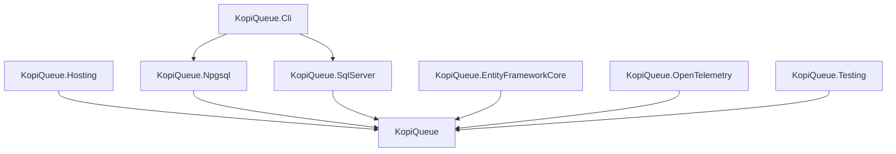
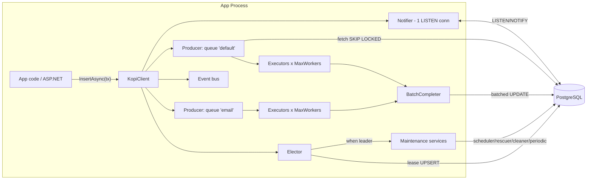
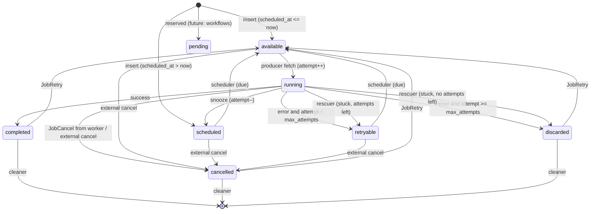

# KopiQueue — Technical Design

**Version:** 0.5 (draft) · **Date:** 2026-11-27 · **Related:** [Requirements](01-requirements.md), [Plan](03-plan.md)

---

## 1. Design principles

1. **The database is the coordinator.** All shared state, including leadership, lives in Postgres. Clients do not talk to each other except through LISTEN/NOTIFY, and notifications are only an optimisation: correctness never depends on them.
2. **Transactions are first-class.** Every operation that writes has a form that runs on a connection or transaction the caller owns.
3. **Small, set-based SQL.** Fetching, completing and maintenance are each one statement working on a batch.
4. **Bounded everything.** Batches, channels, retries and timeouts all have limits. Nothing grows without bound.
5. **Idiomatic .NET.** DI, Options, `ILogger`, `CancellationToken`, `IAsyncDisposable`, `System.Threading.Channels`.
6. **Pluggable at clear seams.** These parts can be replaced: driver, serializer, retry policy, middleware, error handler, clock. Everything else is internal.

## 2. Package layout

```
KopiQueue                      Core: client, options, job model, producers, executor, completer,
                               elector, maintenance, migrations runner, abstractions.
                               Depends on: Microsoft.Extensions.{DI,Logging,Options,Hosting}.Abstractions
KopiQueue.Npgsql               PostgreSQL driver (NpgsqlDataSource, COPY, LISTEN/NOTIFY). River-compatible schema.
KopiQueue.SqlServer            SQL Server / Azure SQL driver (Microsoft.Data.SqlClient, batched OPENJSON). Native KQ schema.
KopiQueue.Hosting              AddKopiQueue(), IHostedService, IConfiguration binding, health checks.
KopiQueue.EntityFrameworkCore  InsertAsync(DbContext ...), commit interceptor (local wake-up), migration helper.
                               Provider-neutral: picks the driver from the DbContext's connection type.
KopiQueue.OpenTelemetry        AddKopiQueueInstrumentation() for TracerProvider/MeterProvider.
KopiQueue.Testing              Assertions, TestWorker harness, fake insert client.
KopiQueue.Cli (dotnet tool)    `kopi migrate ... --provider postgres|sqlserver`, `kopi bench`, `kopi validate`.
```

Why split Hosting from Core: a console app or an Azure Function that only inserts jobs should not need `Microsoft.Extensions.Hosting`.
Users install `KopiQueue.Hosting` plus exactly one driver package (`KopiQueue.Npgsql` or `KopiQueue.SqlServer`).
`KopiQueue.EntityFrameworkCore` references only the core. It finds the driver at runtime from the registered client,
so it does not drag in both database clients.
`KopiQueue.Hosting` references only the core too (plan task 2.8). `KopiQueueBuilder`, the object `AddKopiQueue` hands
to its callback, lives in the core, which already depends on the DI abstractions, so each driver package adds its own
`Use…()` method (`UseNpgsql()`) without depending on Hosting, and Hosting never drags in a database client.

### Dependency graph



## 3. Runtime architecture



### 3.1 Components

| Component | Responsibility | Req |
|-----------|----------------|-----|
| **KopiClient** | Public entry point. Insert/admin API. Owns the lifecycle (`StartAsync`/`StopAsync`) of every component below | FR-INS, FR-ADM, FR-HST |
| **Producer** (one per queue) | Decides when to fetch, fetches up to the number of free slots, sends jobs to executors, reacts to pause/resume/cancel | FR-EXE-01..04, FR-QUE-03 |
| **Executor** | Runs one job: DI scope, deserialise args, middleware pipeline, timeout, result classification | FR-EXE-05..09, FR-ERR |
| **BatchCompleter** | Collects job outcomes and writes them in batches (by size or every 50 ms). Applies back-pressure when saturated | FR-EXE-06 |
| **Notifier** | PostgreSQL: one dedicated **non-pooled** connection (`Pooling=false`, `Keepalive=5`; a pool reset silently drops LISTEN) with `LISTEN` on the insert, control and leadership channels. Fans messages out to subscribers. Reconnects with backoff (100 ms → 30 s, jitter) and, after every (re)connect, **wakes all producers and the elector**, because notifications sent while it was down are lost. Disposes a broken connection in the background with a timeout (spike 0.7). SQL Server: none (poll-only) | FR-EXE-03, FR-INS-07 |
| **LocalWaker** | In-process signal from the inserter to the producers of the same client, sent after the commit is known. Works with every driver. It is the only low-latency path on SQL Server | FR-DB-04 |
| **Elector** | Holds the leader lease. Starts and stops maintenance services on gaining and losing leadership | FR-MNT-01 |
| **Maintenance services** | Scheduler, Rescuer, Cleaner, QueueCleaner, PeriodicEnqueuer, Reindexer. Run only on the leader | FR-MNT, FR-PER, FR-SCH |
| **QueueMaintainer** (every client) | Upserts the queue row (`updated_at`) for each configured queue on an interval, and polls `paused_at` | FR-QUE-02/04 |
| **Event bus** | Bounded in-process channels for subscribers. Never blocks the completer: slow subscribers lose events and a counter records the drop | FR-OBS-01 |
| **Driver** | All SQL and connection handling. Exposes typed operations, so the core never builds SQL | NFR-OPS-01 |

### 3.2 Service lifecycle

Every internal component implements an internal `IStartStopService`:

```csharp
internal interface IStartStopService
{
    Task StartAsync(CancellationToken ct);   // returns once the component is running
    Task StopAsync(CancellationToken ct);    // stops; ct tells it to hurry up
}
```

Each runs a single long-lived loop on `Task.Run`, with its own `CancellationTokenSource`.
The client starts them in this order: notifier → elector → queue maintainer → completer → producers.
It stops them in reverse order. The completer is stopped last among the execution components, so that every result is flushed.

### 3.3 Notifier and LocalWaker (plan task 2.2)

- **Driver contract** (`KopiQueue.Drivers`, experimental): `IKopiDriver.CreateListener()` returns an `IKopiListener`, or `null` exactly when `Capabilities.ListenNotify` is false (a conformance case checks this). `ConnectAsync` opens one connection subscribed to every `NotificationTopic` (`Insert`, `Control`, `Leadership`); its `WaitForNotificationAsync` returns `KopiNotification(topic, payload)`. The listener only connects: reconnecting, backoff and resync belong to the core, so every driver gets the same rules. A `KopiQueueConfigurationException` from `ConnectAsync` means retrying cannot help.
- **Notifier** (internal, one per client that works jobs): runs one loop that connects, raises **resync** on every subscriber, then fans notifications out by topic. A lost connection is reconnected after a delay that starts at 100 ms, doubles per failed attempt, is capped at 30 s, and is then shortened by up to 20% at random, so clients that lost the database together do not reconnect in lockstep, even at the cap; a successful connect resets it. The broken connection is disposed in the background with a 5 s timeout and never delays the reconnect. A configuration error disables the notifier for good (`IsDisabled`), and the client then only polls. Subscriber callbacks run on the loop, must only signal, and are isolated from each other. `IsConnected` is the health signal for task 6.5.
- **PostgreSQL listener:** a connection made with `CloneWithAsync` from the data source, which carries its credentials over although `NpgsqlDataSource.ConnectionString` leaves the password out, with `Pooling=false`, `Keepalive=NotifierKeepAlive` (default 5 s) and `Enlist=false`. `NpgsqlDriverOptions.NotifierConnectionString` replaces the data source for this connection (PgBouncer in transaction mode, proxies). Without a configured schema it reads `current_schema()` after connecting. Every channel is checked against the 63-byte limit before `LISTEN` (schema ≤ 46 bytes), and each `LISTEN` quotes its channel. Measured in `NpgsqlNotifierTests`: a terminated backend is replaced and resynced at once; a black-holed connection with `Keepalive=1` is detected in about 2 s.
- **LocalWaker** (internal, owned by `KopiClient`): after a pooled insert, whose commit the client knows about, it wakes this client's subscribers of each queue that received available jobs. Inserts in a caller's transaction are not announced: the client cannot see their commit (on PostgreSQL the `pg_notify` covers them; on SQL Server the EF commit interceptor, task 5.7, will). Skipped duplicates wake nobody.
- **Modes:** `PollOnly` means no notifier; `Auto` means a notifier whenever the driver has a listener; `ListenNotify` requires one. The option arrives with the client options in task 2.7; until then only the mechanics exist.

### 3.4 Producer (plan task 2.3)

- **Driver contract:** `IKopiExecutor.JobGetAvailableAsync(JobGetAvailableParams)` locks and starts up to `Max` due, available jobs of one queue for one client, in fetch order, skipping rows other transactions hold (§5.1). Each returned row is `running`, one attempt further, and records the client in `attempted_by`, which keeps the newest `MaxAttemptedBy` (default 100, as River) entries.
- **Producer** (internal, one per configured queue): one loop, woken by an `Insert` notification naming its queue, a notifier resync, the client's LocalWaker, a freed slot while the queue is full, or the poll interval (default 1 s) passing without any of these. A wake-up is coalescing: any number of signals before a fetch begins are answered by that one fetch. Fetches are at least `FetchCooldown` (default 100 ms) apart. A fetch asks for the free slots, capped at `FetchBatchMax` (default 1,000) and the driver's `MaxRowsPerStatement`; a full batch asks for another fetch at once. The first fetch happens on start.
- **Slots:** each fetched job runs through the run function (the executor, task 2.4) on its own task, with a token that a hard stop cancels, and holds its slot until the function returns. The producer never runs more than `MaxWorkers` at once (FR-EXE-04).
- **Failures:** a failed fetch is logged and tried again at the next wake-up or poll; the loop never ends on an error. A run function that throws is logged and its slot freed.
- **Stop** (§5.9 steps 1–3 for one queue): unsubscribe and stop fetching; a fetch in progress completes, since the database already marked its jobs running. Then wait for the running jobs (soft stop). If the stop token fires first, cancel every job's token and wait at most `HardStopGrace` (default 5 s); jobs still running stay `running` and are rescued later.

### 3.5 Executor (plan task 2.4)

- **Run function:** `JobExecutor.ExecuteAsync(row, hardStop)` is what the producer runs for each job. It returns once the completer (`IJobCompleter`, task 2.6) has *accepted* the outcome, which frees the slot.
- **Scope and worker:** a new DI scope per job (FR-DEF-03), in which the args are deserialised and the worker is resolved or created. A client without DI gets an empty service provider, so workers with public constructors still work. Bad args or a worker that cannot be built fail the attempt without running it.
- **Timeout** (FR-EXE-05): the worker's `Timeout(job)`, else the client's `JobTimeout` (default 1 min). Zero means the client's; `Timeout.InfiniteTimeSpan` (any negative value) means none. The worker's token is cancelled by the timeout or by the client's hard stop.
- **Outcomes** (FR-EXE-08), as River v0.51.2's `jobexecutor.reportError`, so jobs move the same way whichever library works them (table in §5.2):
  - Returning completes the job.
  - A cancellation caused by the client's hard stop **interrupts** the attempt: the job is made `available` now with `attempt − 1` and no error, so a client stop never uses up an attempt.
  - Any other exception, a timeout included, is an error recorded as `{at, attempt, error, trace}`: `at` is when the attempt started, the message is the error and `Exception.ToString()` the trace. A timeout records "The job did not finish within its timeout of …".
  - An error retries after the worker's `NextRetry(job)` (ignored if it throws or is negative), else the default backoff (§5.4), until `attempt ≥ max_attempts` discards the job. A retry due within the scheduler interval (default 5 s) makes the job `available` at once rather than `retryable`, so short retries are not held up by the scheduler.
- **Unknown kinds** follow DQ-3: an error like any other.
- **Job context** (FR-EXE-07): `Job<TArgs>` carries the ID, attempt, metadata and the rest of the row. Reaching the client from a worker comes with the client lifecycle and DI registration (tasks 2.7, 2.8).
- **Job control** (task 2.5, FR-ERR-03, FR-ERR-04): `throw JobControl.Cancel(reason)` finalises the job as `cancelled` with the reason in its errors, whatever attempts are left. `throw JobControl.Snooze(delay)` reschedules it without using an attempt: `attempt − 1`, `metadata.snoozes` plus one (read leniently, as River), no error, and `available` at once when due within the scheduler interval. Both are found when wrapped, for example in an `AggregateException` or as an inner exception.
- **Retry policy** (task 2.5, FR-ERR-01, FR-ERR-02): the public `IRetryPolicy`, with `DefaultRetryPolicy` (`n^4` seconds ±10% for the `n`th error, `MaxDelay` default 24 h). The worker's `NextRetry` wins; a policy that throws, or returns a time in the past, falls back to the default policy, as in River. The client option that sets it arrives with the client options in task 2.7.

### 3.6 Completer (plan task 2.6)

- **Driver contract:** `IKopiExecutor.JobSetStateIfRunningManyAsync(JobSetStateParams[])`, River's `JobSetStateIfRunningMany` (§5.3): one statement for a whole batch; a `null` field leaves its column alone. Only a job still `running` changes, so a completion never clobbers a rescue, a cancel or a delete; metadata updates merge either way. A running job with `cancel_attempted_at` whose outcome would run it again becomes `cancelled`, finalised now, with its attempt and schedule kept and the error still appended (§5.8). It returns every given job that exists, changed or not, in ID order. Errors are stored in River's JSON, `{"at", "attempt", "error", "trace"}`, with the time as Go's RFC 3339 in UTC and an empty trace for none.
- **Completers** (internal, `CompleterKind`): `Batch` (default) queues completions in a bounded channel (twice the batch size) and writes a batch when it reaches 2,000 (or the driver's row limit) or 50 ms after its first completion; a full queue makes executors wait, which slows the producers down. `Async` writes each completion on its own, at most 100 at once. `Inline` writes before returning.
- **Failures:** a failed write is retried after 100 ms, doubling to 5 s, until it succeeds or a hard stop abandons it; the jobs then stay `running` and are rescued later. Nothing is dropped or thrown at the executor (NFR-REL-04).
- **Reporting** (NFR-REL-03): `onCompleted` receives each completion with its stored row only after the write committed; this is where events (task 6.x) will hang. The row's state shows what actually happened, for example `cancelled` instead of `retryable`.
- **Stop** (§5.9 step 4): after the producers stop, `StopAsync` writes what is pending; if its token fires first it abandons the rest. The client option that picks the completer arrives with the client options in task 2.7.

### 3.7 Client lifecycle (plan task 2.7)

- **Configuring:** `KopiClientOptions` gains `Queues` (name → `QueueOptions { MaxWorkers }`), `Workers`, `Services` (the DI root for per-job scopes), `LoggerFactory`, `ClientId`, `JobTimeout`, `RetryPolicy`, `FetchPollInterval`, `FetchCooldown`, `FetchBatchMax`, `NotificationMode`, `CompleterMode`, `SoftStopTimeout` and `HardStopGrace`, with the defaults of §7. Hosting (task 2.8) binds these from configuration.
- **`StartAsync`** checks the configuration before it builds anything (FR-DEF-06): queues and workers go together; each queue name follows the insert rules and has 1–10,000 workers; `WorkerRegistry.ValidateForWork` passes; the times are in range; `ListenNotify` needs a driver that can listen. Any failure throws `KopiQueueConfigurationException` and nothing starts. It then starts the completer, the notifier (unless `PollOnly`, or the driver cannot listen) and one producer per queue. A client with no queues and no workers is insert-only: `StartAsync` does nothing and the client still opens no connection (FR-INS-08). A client starts once.
- **`StopAsync(ct)`** follows §5.9 and is idempotent; concurrent callers share one stop. Steps 2–3: the soft stop ends when `ct` fires or `SoftStopTimeout` passes; the hard stop cancels the job tokens, the executor stores interrupted jobs as `available` without using an attempt, and the producers wait at most `HardStopGrace`. Step 4: the completer gets another `HardStopGrace` to write. Step 5: the elector steps down and resigns within another `HardStopGrace` (task 3.1, §5.5). Inserting keeps working after a stop.
- **Queues (task 3.6):** a working client also starts a QueueMaintainer, after the elector and before the producers, and stops it once fetching has stopped (step 1). See §3.8.
- **Not yet:** the scheduler (task 3.3) moves `scheduled` and `retryable` jobs to `available` once due; until it lands, only jobs inserted `available`, retries due within 5 s, and interrupted jobs run again.

### 3.8 Queues, pause and resume (plan task 3.6)

FR-QUE-02..04, FR-ADM-04, FR-DB-05. Every client that works queues runs a **QueueMaintainer** (`Execution/QueueMaintainer`), leader or not:

- **Rows:** when it starts, it creates its queues' rows or marks them worked (`QueueCreateOrSetUpdatedAtManyAsync`: an `INSERT … ON CONFLICT DO UPDATE SET updated_at`, in name order so clients cannot deadlock), then repeats that every minute, so the queue cleaner (task 3.5) keeps them. `QueueRetention` must therefore be at least 5 minutes. The first refresh applies the pause state before any producer fetches, so a queue paused while no client ran is never fetched. A failed refresh is logged and retried at the next poll.
- **Pause everywhere:** `QueuePauseAsync(name)` / `QueueResumeAsync(name)`, `"*"` for all, store the state and announce it on `river_control` in one statement (§4.3). They behave as River's did in the black-box runs of tasks 2.10 and 3.6 (since removed, ADR-008): pausing sets `paused_at` and `updated_at` only on a queue not yet paused, resuming clears it only on a paused one, the notification goes out even when nothing changed, and an unknown queue is an error (`KopiQueueNotFoundException`; River's "not found") with no notification.
- **Reaching other clients (FR-QUE-04):** a control notification pauses or resumes the producers at once. While the notifier is not connected, or in poll-only mode, or on a driver without notifications (FR-DB-05), the maintainer reads its queues' `paused_at` every `FetchPollInterval` (1 s) instead, and once after the notifier reconnects. A read that a notification overtook is discarded and repeated, so a stale row cannot undo a newer pause. The calling client applies its own pause at once.
- **Pause locally:** `QueuePauseOptions.LocalOnly` pauses this client's producer only and stores nothing. A producer fetches only while it is resumed both locally and everywhere.
- **Producers** (§3.4) skip fetching while paused; jobs already running finish. Resuming wakes the producer, which fetches at once.
- **Admin (FR-ADM-04):** `QueueGetAsync`, `QueueListAsync` (name order, `Limit` up to 10,000, keyset `After`) and `QueueUpdateAsync(name, metadata)`, which replaces the metadata, sets `updated_at` and announces `{"action": "metadata_changed", "metadata": …, "queue": …}` as River does. Caller-transaction variants come with task 4.4 (FR-ADM-05).

## 4. Data model

> **PostgreSQL (River-compatible, OQ-1 decided):** the table names and columns below MUST match River's schema at the pinned version: **migration line `main`, version 8, as created by River v0.51.2**.
> The exact shape was taken in [spike 0.8](spikes/0.8-river-schema-and-unique-keys.md), which introspects a database migrated by River's own CLI. Since task 1.2, CI checks it on every supported PostgreSQL version: after each version of the main line, up and down, KQ's catalog must equal River's (§4.1.1).
> The prefix is configurable: `river_` (default, compatible) or `kopi_` (no compatibility).
> **SQL Server:** KQ's own schema with the same logical model, see §4.4.

### 4.1 Tables (PostgreSQL)

```sql
CREATE TYPE river_job_state AS ENUM (
  'available', 'cancelled', 'completed', 'discarded',
  'pending', 'retryable', 'running', 'scheduled'
);

CREATE TABLE river_job (
  id            bigserial PRIMARY KEY,
  state         river_job_state NOT NULL DEFAULT 'available',
  attempt       smallint        NOT NULL DEFAULT 0,
  max_attempts  smallint        NOT NULL DEFAULT 25,
  attempted_at  timestamptz,
  created_at    timestamptz     NOT NULL DEFAULT now(),
  finalized_at  timestamptz,
  scheduled_at  timestamptz     NOT NULL DEFAULT now(),
  priority      smallint        NOT NULL DEFAULT 1,
  args          jsonb           NOT NULL,
  attempted_by  text[],
  errors        jsonb[],
  kind          text            NOT NULL,
  metadata      jsonb           NOT NULL DEFAULT '{}',
  queue         text            NOT NULL DEFAULT 'default',
  tags          varchar(255)[]  NOT NULL DEFAULT '{}',
  unique_key    bytea,
  unique_states bit(8),

  CONSTRAINT finalized_or_finalized_at_null CHECK (
    (finalized_at IS NULL AND state NOT IN ('cancelled','completed','discarded')) OR
    (finalized_at IS NOT NULL AND state IN ('cancelled','completed','discarded'))),
  CONSTRAINT max_attempts_is_positive CHECK (max_attempts > 0),
  CONSTRAINT priority_in_range        CHECK (priority BETWEEN 1 AND 4),
  CONSTRAINT queue_length             CHECK (char_length(queue) > 0 AND char_length(queue) < 128),
  CONSTRAINT kind_length              CHECK (char_length(kind)  > 0 AND char_length(kind)  < 128)
);

-- Fetching: the hot path
CREATE INDEX river_job_prioritized_fetching_index
  ON river_job (state, queue, priority, scheduled_at, id);
-- Cleaner
CREATE INDEX river_job_state_and_finalized_at_index
  ON river_job (state, finalized_at) WHERE finalized_at IS NOT NULL;
CREATE INDEX river_job_kind      ON river_job (kind);
CREATE INDEX river_job_args_index     ON river_job USING gin (args);
CREATE INDEX river_job_metadata_index ON river_job USING gin (metadata);

-- Uniqueness, enforced only while the job is in one of its unique_states
CREATE FUNCTION river_job_state_in_bitmask(bitmask bit(8), state river_job_state)
RETURNS boolean LANGUAGE sql IMMUTABLE AS $$ ... $$;   -- maps state → bit position
CREATE UNIQUE INDEX river_job_unique_idx ON river_job (unique_key)
  WHERE unique_key IS NOT NULL AND unique_states IS NOT NULL
    AND river_job_state_in_bitmask(unique_states, state);

CREATE UNLOGGED TABLE river_leader (
  name       text PRIMARY KEY DEFAULT 'default' CHECK (name = 'default'),
  leader_id  text NOT NULL CONSTRAINT leader_id_length CHECK (char_length(leader_id) > 0 AND char_length(leader_id) < 128),
  elected_at timestamptz NOT NULL,
  expires_at timestamptz NOT NULL
);

CREATE TABLE river_queue (
  name       text PRIMARY KEY,
  created_at timestamptz NOT NULL DEFAULT now(),
  updated_at timestamptz NOT NULL DEFAULT CURRENT_TIMESTAMP,
  paused_at  timestamptz,
  metadata   jsonb NOT NULL DEFAULT '{}'
);

CREATE TABLE river_migration (
  line       text   NOT NULL CONSTRAINT line_length CHECK (char_length(line) > 0 AND char_length(line) < 128),
  version    bigint NOT NULL CONSTRAINT version_gte_1 CHECK (version >= 1),
  created_at timestamptz NOT NULL DEFAULT now(),
  CONSTRAINT river_migration_pkey1 PRIMARY KEY (line, version)   -- "pkey1" is River's name from version 5 on
);

-- Notification outbox for drivers without LISTEN/NOTIFY. Part of the pinned schema; unused by KQ on PostgreSQL
CREATE TABLE river_notification (
  id         bigserial   PRIMARY KEY,
  created_at timestamptz NOT NULL DEFAULT now(),
  topic      text        NOT NULL CONSTRAINT topic_length CHECK (length(topic) > 0 AND length(topic) < 128),
  payload    text        NOT NULL
);
CREATE INDEX river_notification_created_at_idx ON river_notification (created_at);
CREATE INDEX river_notification_topic_id_idx   ON river_notification (topic, id);
```

The DDL above is a summary. The authoritative definition is the migration SQL in `src/KopiQueue.Npgsql/Migrations/main/`, whose result is compared with River's catalog in CI (§4.1.1): every name, column order, type, default, constraint, index and function signature is identical. For example, `river_leader`'s columns are in the order `elected_at, expires_at, leader_id, name`. The names are kept identical so that later River migrations, which may refer to them, apply cleanly.

Design notes:

- KQ's migrator creates exactly the pinned objects, including `river_notification`, and records versions 1–8 in `river_migration` (line `main`). A later `river migrate-up` from River's CLI then continues from a consistent state.
- `river_leader` is `UNLOGGED`. Losing its data on a crash is fine because leadership is re-elected, and an unlogged table avoids WAL writes for frequent lease renewals.
- `errors jsonb[]` holds one element per failed attempt: `{ "at", "attempt", "error", "trace" }`. The size is capped and the trace truncated (NFR-SEC-03).
- `attempted_by` is capped at the last N client IDs so the row does not grow without bound.
- `metadata` holds internal keys under reserved names, for example `cancel_attempted_at`, `snoozes` and `traceparent`. User keys are free-form.

#### 4.1.1 The main line, version by version (plan task 1.2)

KQ ships all eight versions, not just the final schema, so that it can continue a database River migrated part of the way, and River can continue one KQ migrated. Each version was written clean-room from black-box observation of River v0.51.2's CLI: migrate a scratch schema one version at a time, read its catalog (shape only, no function bodies), and probe how each step treats existing rows.

| Version | Up | Down |
|---------|----|------|
| 1 | `river_migration` in its original shape: `id bigserial`, `created_at`, `version` (unique, `CHECK version >= 1`) | Drop it |
| 2 | `river_job_state` (7 values), `river_job` with its indexes, `river_leader` (UNLOGGED), and an `AFTER INSERT` trigger that calls `pg_notify('river_insert', '{"queue" : "<queue>"}')` for rows inserted as `available` | Drop them |
| 3 | `tags`: NULLs become `{}`, then `DEFAULT '{}' NOT NULL` | Drop the default and NOT NULL |
| 4 | Add enum value `pending`; NULL `args` and `metadata` become `{}`, then NOT NULL; stricter `finalized_or_finalized_at_null`; drop the trigger; add `river_queue`; `river_leader.name` gets `DEFAULT 'default'` and `CHECK (name = 'default')` (fails while a row has another name) | Reverse everything **except** the `pending` value, and also make `metadata` nullable without a default: River's own down leaves that state |
| 5 | Replace the migration table with `(line, version, created_at)`, copying rows as line `main` with their timestamps; add `unique_key` and the unique index on `(kind, unique_key)`; add UNLOGGED `river_client` and `river_client_queue` | Refuse while other lines are recorded; otherwise restore the original table and drop the rest |
| 6 | Add `unique_states bit(8)`, `river_job_state_in_bitmask` and `river_job_unique_idx`; drop the `(kind, unique_key)` index. Existing rows are not backfilled | Reverse; recreating the old index fails while two rows share `(kind, unique_key)` |
| 7 | Drop `river_client*`; add `river_notification`; `max_attempts DEFAULT 25`; `river_queue.updated_at DEFAULT CURRENT_TIMESTAMP` | Reverse |
| 8 | Nothing on PostgreSQL: the catalog is identical before and after it (in River the version matters for other databases) | Nothing |

- **Migration table shapes.** Versions 1–4 use the original table, which can only record the `main` line. The driver detects the shape each time it reads or writes a version, so any other line needs `main` at version 5 or later.
- **Bitmask function.** `river_job_state_in_bitmask(bitmask, state)` returns the bit for `state`. From left to right the bits are scheduled, running, retryable, pending, discarded, completed, cancelled, available. A NULL bitmask gives NULL and a NULL state gives false. Tests check all 2,048 inputs against River's function.
- **Goldens and checks.** `tests/KopiQueue.Npgsql.Tests/Migrations/River/v0.51.2/` holds River's catalog after each up version, plus the two down states that differ (versions 2 and 3). The tests compare KQ against them at every version, up and down. `state-bitmask.txt` holds `river_job_state_in_bitmask`'s result for every mask and state. The goldens were recorded from River's CLI, and CI checked them against it until 36f3d90; KQ's tests no longer run River (ADR-008), so they are fixed data. A new pinned version needs its goldens derived from River's documentation and changelog.
- **Prefix.** With another prefix, for example `kopi_`, the same objects are created with that prefix and can coexist with `river_` objects in one schema. Trigger, channel and column names that are fixed in River (for example `river_insert` and `river_client_id`) stay as they are.

### 4.2 Job state machine



Invariant (DB-enforced): `finalized_at IS NOT NULL ⇔ state ∈ {completed, cancelled, discarded}`.

### 4.3 Notification channels

| Channel | Payload (JSON) | Sender | Consumer |
|---------|----------------|--------|----------|
| `"<schema>.river_insert"` | `{"queue":"email"}` | Inserter (inside the caller's tx, via `pg_notify`), scheduler | Producer for that queue → fetch now |
| `"<schema>.river_control"` | `{"action":"cancel","job_id":123,"queue":"email"}` / `{"action":"pause"\|"resume","queue":"*"\|"email"}` | Admin API | Producers |
| `"<schema>.river_leadership"` | `{"action":"resigned","leader_id":"..."}` | Elector | Electors → try to win immediately |

Channel rules (spikes 0.7 and 0.8):

- Channels are **schema-qualified** (River uses `public.river_insert` for the default schema) and are always **quoted** in `LISTEN`. Unquoted, the dot is a syntax error.
- `LISTEN` silently truncates names over 63 bytes, while `pg_notify` rejects them. With notifications enabled, the schema name must therefore be **≤ 46 bytes**; this is validated at startup.
- Payloads are parsed as JSON, never compared as strings: River sends jsonb text such as `{"queue": "default"}`. The limit is 7,999 bytes.
- Commit-to-delivery latency was p50 0.22 ms locally. Postgres collapses identical channel + payload pairs within one transaction, and delivers nothing on rollback or for a rolled-back savepoint.

Because `pg_notify` is called inside the caller's transaction, Postgres delivers the notification only on commit. This satisfies FR-INS-07 for free.

Observed with a running River v0.51.2 client in the black-box interop suite of plan task 2.10 (removed when KQ stopped running River, ADR-008; these notes stay as the reference):

- **Inserts:** an insert-only River client does notify on `"<schema>.river_insert"`, but only **once per queue for a burst**. Three `Insert` calls in quick succession gave one notification; a later insert and an insert into another queue each gave one. One `InsertMany` is one transaction and one notification. So a KopiQueue producer woken by River's first notification can miss the rest of a River burst until its next poll (`FetchPollInterval`, 1 s by default). Open question for M3: refetch once shortly after a notification-driven fetch.
- **Leadership:** a running River client holds the `river_leader` row while it leads and deletes it when it stops, sending `{"leader_id": "...", "action": "resigned"}` on `"<schema>.river_leadership"`. Nothing is sent when a client is elected. The elector (task 3.1) matches this, and the two interoperate: neither takes the other's unexpired lease, a KopiQueue follower takes over as soon as River resigns, and a River follower took over about 30 ms after KopiQueue resigned, so River reacts to KopiQueue's announcement.
- **Control:** nothing was sent on `"<schema>.river_control"` during a client's life without admin actions. River's `QueuePause`, `QueueResume` and `QueueUpdate` (task 3.6) send `{"action":"pause"|"resume","queue":"<name>"|"*"}` and `{"action":"metadata_changed","metadata":{…},"queue":"<name>"}`, also when nothing changed; an unknown queue fails with "not found" and sends nothing. A starting River worker creates its queue's row. KopiQueue does the same, step for step, and each library stops fetching a queue the other paused: a River worker fetched about 80 ms after KopiQueue resumed its queue (§3.8).

**Behind PgBouncer (plan task 2.11, NFR-COMP-04), checked in CI by `NpgsqlPgBouncerTests`:**

- **Transaction mode:** fetching, completing and every way of inserting (single, batch, `COPY`, in the caller's transaction) work. Inserts still notify on commit, because `pg_notify` runs inside the transaction. `LISTEN` does not work through it, so either run the client in `PollOnly` mode or point `NpgsqlDriverOptions.NotifierConnectionString` at PostgreSQL directly, which keeps notification-driven pick-up. Set `No Reset On Close=true` on the data source, as Npgsql advises for PgBouncer.
- **Migrations** take a session-level advisory lock (FR-MIG-06), so run them directly or through session mode, never through transaction mode.
- **Session mode** behaves like a direct connection: migrations, `LISTEN` and everything else work.

How the PostgreSQL driver sends it (plan task 1.6):

- `JobInsertManyAsync` sends the `INSERT` and one `pg_notify` statement as a single Npgsql batch. Without a caller transaction, PostgreSQL runs a batch as one implicit transaction, so a pooled insert and its notification also commit or fail together.
- It notifies each queue that received `available` jobs once per call; scheduled jobs are announced later by the scheduler.
- The payload is `jsonb_build_object('queue', ...)::text`, that is `{"queue": "email"}`, the same text River sends.
- With no schema configured, the channel uses `current_schema()`, as River's `public.river_insert` does.
- A channel over 63 bytes is skipped rather than failing the insert. The notifier refuses such a schema when it connects (§3.3), which disables notifications for that client.
Insert notifications are **debounced** per queue: at most one per queue per transaction, and producers coalesce wake-ups within the fetch cooldown.

On SQL Server none of these channels exist. Each one is replaced as follows (FR-DB-04/05):

| PostgreSQL channel | SQL Server replacement |
|--------------------|------------------------|
| `river_insert` | LocalWaker for inserts from the same process, plus the producer poll (`FetchPollInterval`, default 1 s, minimum 100 ms) |
| `river_control` cancel | Producers poll `cancel_attempted_at` for their running job ids on every fetch cycle (design §5.8 step 4) |
| `river_control` pause/resume | QueueMaintainer polls `kopi_queue.paused_at` (default every 1 s on SQL Server) |
| `river_leadership` resigned | Electors retry at the normal elect interval. A graceful resign deletes the row, so the next attempt wins at once |

### 4.4 Tables (SQL Server)

Same logical model as §4.1. Mapping:

| Concept | PostgreSQL | SQL Server |
|---------|------------|------------|
| Job id | `bigserial` | `bigint IDENTITY`, clustered PK |
| State | enum `river_job_state` | `varchar(16)` + `CHECK (state IN (...))` |
| Timestamps | `timestamptz` | `datetime2(6)` holding **UTC**, set with `SYSUTCDATETIME()` |
| args / metadata | `jsonb` | `nvarchar(max)` + `CHECK (ISJSON(x) = 1)`. Native `json` on SQL Server 2025 / Azure SQL behind a feature check (OQ-7) |
| tags / attempted_by / errors | arrays | `nvarchar(max)` holding a JSON array |
| unique_states | `bit(8)` | `tinyint` bitmask (same bit mapping in code for both drivers) |
| Leader table | `UNLOGGED` | Ordinary table. One row, written every 5 s, so write cost is negligible |
| GIN indexes on args/metadata | yes | none. Admin filters on JSON content scan the table; documented |

```sql
CREATE TABLE kopi_job (
  id            bigint IDENTITY(1,1) NOT NULL CONSTRAINT kopi_job_pk PRIMARY KEY CLUSTERED,
  state         varchar(16)    NOT NULL CONSTRAINT kopi_job_state_df DEFAULT 'available',
  attempt       smallint       NOT NULL DEFAULT 0,
  max_attempts  smallint       NOT NULL,
  attempted_at  datetime2(6)   NULL,
  created_at    datetime2(6)   NOT NULL DEFAULT SYSUTCDATETIME(),
  finalized_at  datetime2(6)   NULL,
  scheduled_at  datetime2(6)   NOT NULL DEFAULT SYSUTCDATETIME(),
  priority      smallint       NOT NULL DEFAULT 1,
  args          nvarchar(max)  NOT NULL,
  attempted_by  nvarchar(max)  NULL,
  errors        nvarchar(max)  NULL,
  kind          nvarchar(128)  NOT NULL,
  metadata      nvarchar(max)  NOT NULL DEFAULT N'{}',
  queue         nvarchar(128)  NOT NULL DEFAULT N'default',
  tags          nvarchar(max)  NOT NULL DEFAULT N'[]',
  unique_key    varbinary(32)  NULL,
  unique_states tinyint        NULL,
  -- 0 while the job "occupies" its unique slot, otherwise its own id (see ADR-011)
  unique_slot AS CAST(CASE
      WHEN unique_key IS NOT NULL AND unique_states IS NOT NULL
       AND (unique_states & CASE state
             WHEN 'available' THEN 1   WHEN 'cancelled' THEN 2  WHEN 'completed' THEN 4
             WHEN 'discarded' THEN 8   WHEN 'pending'   THEN 16 WHEN 'retryable' THEN 32
             WHEN 'running'   THEN 64  WHEN 'scheduled' THEN 128 END) <> 0
      THEN 0 ELSE id END AS bigint) PERSISTED,

  CONSTRAINT kopi_job_state_valid CHECK (state IN
    ('available','cancelled','completed','discarded','pending','retryable','running','scheduled')),
  CONSTRAINT kopi_job_finalized_or_finalized_at_null CHECK (
    (finalized_at IS NULL     AND state NOT IN ('cancelled','completed','discarded')) OR
    (finalized_at IS NOT NULL AND state     IN ('cancelled','completed','discarded'))),
  CONSTRAINT kopi_job_max_attempts_is_positive CHECK (max_attempts > 0),
  CONSTRAINT kopi_job_priority_in_range        CHECK (priority BETWEEN 1 AND 4),
  CONSTRAINT kopi_job_queue_length CHECK (LEN(queue) BETWEEN 1 AND 128),
  CONSTRAINT kopi_job_kind_length  CHECK (LEN(kind)  BETWEEN 1 AND 128),
  CONSTRAINT kopi_job_args_json     CHECK (ISJSON(args) = 1),
  CONSTRAINT kopi_job_metadata_json CHECK (ISJSON(metadata) = 1)
);

-- Hot fetch path: filtered to available rows only, so it stays small
CREATE INDEX kopi_job_fetch_idx     ON kopi_job (queue, priority, scheduled_at, id) WHERE state = 'available';
-- Scheduler
CREATE INDEX kopi_job_schedule_idx  ON kopi_job (scheduled_at) INCLUDE (queue) WHERE state IN ('scheduled','retryable');
-- Rescuer
CREATE INDEX kopi_job_running_idx   ON kopi_job (attempted_at) WHERE state = 'running';
-- Cleaner
CREATE INDEX kopi_job_finalized_idx ON kopi_job (state, finalized_at) WHERE finalized_at IS NOT NULL;
CREATE INDEX kopi_job_kind_idx      ON kopi_job (kind);
-- Uniqueness (no filter needed: rows outside their unique states get unique_slot = id)
CREATE UNIQUE INDEX kopi_job_unique_idx ON kopi_job (unique_key, unique_slot);

CREATE TABLE kopi_leader (
  name       varchar(16)   NOT NULL CONSTRAINT kopi_leader_pk PRIMARY KEY DEFAULT 'default' CHECK (name = 'default'),
  leader_id  nvarchar(128) NOT NULL,
  elected_at datetime2(6)  NOT NULL,
  expires_at datetime2(6)  NOT NULL
);

CREATE TABLE kopi_queue (
  name       nvarchar(128) NOT NULL CONSTRAINT kopi_queue_pk PRIMARY KEY,
  created_at datetime2(6)  NOT NULL DEFAULT SYSUTCDATETIME(),
  updated_at datetime2(6)  NOT NULL,
  paused_at  datetime2(6)  NULL,
  metadata   nvarchar(max) NOT NULL DEFAULT N'{}' CHECK (ISJSON(metadata) = 1)
);

CREATE TABLE kopi_migration (
  line       nvarchar(128) NOT NULL,
  version    bigint        NOT NULL,
  created_at datetime2(6)  NOT NULL DEFAULT SYSUTCDATETIME(),
  CONSTRAINT kopi_migration_pk PRIMARY KEY (line, version)
);
```

SQL Server notes:

- Filtered indexes and indexed computed columns need `ANSI_NULLS`, `QUOTED_IDENTIFIER`, `ANSI_PADDING`, `ANSI_WARNINGS`, `ARITHABORT` and `CONCAT_NULL_YIELDS_NULL` ON, and `NUMERIC_ROUNDABORT` OFF, in every session that writes the table. SqlClient's defaults satisfy this, with one subtlety verified in M0: SqlClient leaves `ARITHABORT` **OFF**, but at compatibility level ≥ 90 `ANSI_WARNINGS ON` implies it. The driver checks the options on first use and fails fast if a session (for example one opened by other code with `SET ANSI_WARNINGS OFF`) would break writes.
- Every batch statement stays below 5,000 rows (the lock-escalation threshold), so row locks never escalate to a table lock while producers fetch.
- The schema (default `dbo`) and the prefix are substituted into the SQL after validation and quoted with `QUOTENAME` rules.

## 5. Key algorithms

### 5.1 Fetch (producer)

```sql
WITH locked AS (
  SELECT id FROM river_job
  WHERE state = 'available' AND queue = @queue AND scheduled_at <= now()
  ORDER BY priority, scheduled_at, id
  LIMIT @limit
  FOR UPDATE SKIP LOCKED
)
UPDATE river_job j
SET state        = 'running',
    attempt      = j.attempt + 1,
    attempted_at = now(),
    attempted_by = (j.attempted_by || @client_id::text)[greatest(1, cardinality(j.attempted_by) - 99):]
FROM locked
WHERE j.id = locked.id
RETURNING j.*;
```

Producer loop (pseudo):

```
loop:
  wait until (insert notification for my queue) OR (poll timer, default 1 s) OR stop
  if paused: continue
  wait out the fetch cooldown (default 100 ms) since the last fetch   // coalesces bursts
  free = MaxWorkers - running
  if free == 0: continue            // woken again when an executor finishes
  jobs = Fetch(limit = min(free, FetchBatchMax))
  for job in jobs: start Executor(job) on a slot
  if jobs.Count == limit: schedule an immediate refetch (more work is likely)
```

`UPDATE ... RETURNING` returns rows in no particular order, so the driver sorts them into fetch order. `attempted_by` keeps its newest 100 entries, as River's does.

Concurrency control: each producer tracks its running jobs and fetches no more than `MaxWorkers` minus the running count. A slot is released after the completer has *accepted* the result, not after it has been written to the database. This keeps slots from waiting on database writes.

### 5.2 Execute (executor)

```
using scope = services.CreateAsyncScope()
args   = serializer.Deserialize(job.Args, registry.TypeFor(job.Kind))       // NFR-SEC-02
worker = registry[job.Kind].Create(scope)   // from the scope, or constructed with its dependencies
timeout = worker.Timeout(job) ?? options.JobTimeout                          // default 1 min
using cts = CreateLinkedTokenSource(clientHardStopToken, jobCancelToken)
cts.CancelAfter(timeout)
try   await pipeline(middlewares..., worker.WorkAsync)(job, cts.Token)
      → Completed
catch JobCancelException     → Cancelled (reason recorded in errors)
catch JobSnoozeException(d)  → Snoozed(d)
catch OperationCanceledException when the hard stop fired → Interrupted
catch OperationCanceledException when the timeout fired → Error(timeout)
catch Exception e            → errorHandler?.HandleError(job, e) may override; else Error(e)
outcome → completer.Enqueue(job.Id, outcome)
```

Job control from workers uses exceptions, the idiomatic .NET way to unwind. Static helpers make the code read naturally:

```csharp
throw JobControl.Cancel("customer deleted");
throw JobControl.Snooze(TimeSpan.FromMinutes(5));
```

Classifying outcomes into states:

| Outcome | New state | Fields |
|---------|-----------|--------|
| Completed | `completed` | `finalized_at = now()` |
| Interrupted (hard stop) | `available` | `scheduled_at = now()`, `attempt = attempt − 1`; no error |
| Error, attempt < max | `retryable`, or `available` if due within the scheduler interval | `scheduled_at = now() + NextRetry(job)`, append to `errors` |
| Error, attempt ≥ max | `discarded` | `finalized_at = now()`, append to `errors` |
| Cancel | `cancelled` | `finalized_at = now()`, append to `errors` |
| Snooze(d) | `scheduled`, or `available` if due within the scheduler interval | `scheduled_at = now() + d`, `attempt = attempt − 1`, `metadata.snoozes = snoozes + 1` |

These are River v0.51.2's rules (`jobexecutor.reportResult` and `reportError`), read from its source in task 2.4. An earlier draft of this table had a snooze raise `max_attempts`; River decrements `attempt` instead, which also keeps a snooze out of an attempt-based backoff.

### 5.3 Batch complete

```sql
UPDATE river_job j
SET state        = u.state,
    finalized_at = u.finalized_at,
    scheduled_at = coalesce(u.scheduled_at, j.scheduled_at),
    max_attempts = coalesce(u.max_attempts, j.max_attempts),
    errors       = CASE WHEN u.error IS NULL THEN j.errors ELSE array_append(j.errors, u.error) END,
    metadata     = j.metadata || coalesce(u.metadata_patch, '{}')
FROM unnest(@ids, @states, @finalized_at, @scheduled_at, @max_attempts, @errors, @metadata_patch)
     AS u(id, state, finalized_at, scheduled_at, max_attempts, error, metadata_patch)
WHERE j.id = u.id
  AND j.state = 'running'            -- guard: don't clobber a concurrent rescue or delete
RETURNING j.*;
```

- Flushed when the batch reaches 2,000 rows or 50 ms have passed, whichever comes first.
- If a job was cancelled from outside while running (`metadata.cancel_attempted_at` is set) and the worker then returned an error, the outcome becomes `cancelled`, not `retryable`.
- When the database is unavailable, the completer retries with backoff. Its bounded input channel fills, which naturally slows the producers down (back-pressure).
- Events are published only after the batch commits (NFR-REL-03).

Completer variants (option): `Batch` (default), `Async` (one update per job, run in parallel), and `Inline` (synchronous, mainly for tests).

### 5.4 Retry policy

```csharp
public interface IRetryPolicy { DateTimeOffset NextRetry(JobRow job, DateTimeOffset now); }

// Default: n^4 seconds, ±10% jitter, capped at 24 h, where n = errors.Count + 1 (as River: errors, not attempts).
// 1st error → 1 s, 2nd → 16 s, 3rd → 81 s, 5th → ~10 min, 10th → ~2.8 h, 25th → capped.
```

The worker's `NextRetry(job)` override wins over the client policy. It returns a delay (`TimeSpan?`), not a time, so a worker needs no clock and tests stay deterministic under `FakeTimeProvider`; `null` means "use the policy".

### 5.5 Leader election

```sql
-- Try to win (every ElectInterval, default 5 s, when not leader). A row back ⇒ won.
INSERT INTO river_leader AS l (leader_id, elected_at, expires_at)
VALUES (@id, now(), now() + @ttl)
ON CONFLICT (name) DO UPDATE
  SET leader_id = EXCLUDED.leader_id,
      elected_at = CASE WHEN l.leader_id = EXCLUDED.leader_id THEN l.elected_at ELSE EXCLUDED.elected_at END,
      expires_at = EXCLUDED.expires_at
  WHERE l.expires_at < now() OR l.leader_id = EXCLUDED.leader_id
RETURNING l.leader_id;

-- Renew (every ElectInterval when leader). No row ⇒ lost leadership
UPDATE river_leader SET expires_at = now() + @ttl WHERE leader_id = @id RETURNING leader_id;

-- Resign (graceful stop): delete and announce in one statement, only if this client held the lease
WITH resigned AS (DELETE FROM river_leader WHERE leader_id = @id RETURNING leader_id)
SELECT r.leader_id, pg_notify('<schema>.river_leadership', json_build_object('leader_id', r.leader_id, 'action', 'resigned')::text)
FROM resigned AS r;   -- channel over 63 bytes: skipped, as for inserts
```

Implemented in plan task 3.1 (`Execution/Elector`, driver operations `LeaderAttemptElectAsync`, `LeaderAttemptReelectAsync`, `LeaderResignAsync`; SQL in `KopiQueue.Npgsql/Sql/leader_*.sql`):

- A holder that tries to win again keeps the lease, so the attempt is safe to repeat.
- The TTL (default 15 s, at least 2 × ElectInterval) is larger than ElectInterval (5 s) plus jitter (±10%), so one slow renewal does not cost leadership.
- **Safety margin:** the leader steps down at TTL − TTL/3 after the start of its last successful election or renewal, measured on its own clock before the statement was sent, unless a renewal succeeds first. Each renewal is cancelled at that time, so a hung connection cannot delay it. Losing the lease to another client (renewal returns no row) steps down at once. Stepping down awaits the leadership callback, which stops the maintenance services (task 3.2) **before** the lease can pass to another client. Maintenance must also be safe when two leaders briefly overlap: every maintenance statement is idempotent and uses `SKIP LOCKED`.
- **Waking:** a follower tries at once when another client's `resigned` notification arrives, and after the notifier reconnects. Its own resignation, and other messages, are ignored. Nothing is announced on election, as River (§4.3).
- **Stop:** the leader steps down, then resigns, within `HardStopGrace` (§5.9 step 5). Disposing without stopping, like a crash, leaves the lease to expire.
- Only a client that works jobs elects; an insert-only client never touches the lease (§6.2).
- `ClientId` is at most 127 characters, the limit of `river_leader.leader_id`; the default ID shortens the machine name to fit.

### 5.6 Unique jobs

- **Unique key** (reconstructed black-box in spike 0.8; reproduces 22 of 22 River v0.51.2 golden vectors): `SHA-256` over the concatenation of the enabled parts, in this order:
  - `&kind=<kind>`, unless `ExcludeKind` is set;
  - `&args=<canonical args>` (`ByArgs`);
  - `&period=<floor(now / period) * period as RFC 3339 UTC, seconds, "Z">` (`ByPeriod`);
  - `&queue=<queue>` (`ByQueue`).
- **Canonical args:** the top-level members of the serialised args, restricted to properties marked `[UniqueKey]` if the type has any. They are sorted bytewise by name, and each value's JSON text is copied **verbatim**; nested objects are not re-sorted. The state set and the period length are **not** part of the key.
- Because values are copied verbatim, cross-language deduplication with Go producers needs Go-compatible JSON escaping (DQ-8).
- `unique_states` is a bitmask of the states in which the key "occupies" the slot. The partial unique index enforces it only while the row's current state is in the mask. The bit order in `bit(8)` text, left to right, is `scheduled, running, retryable, pending, discarded, completed, cancelled, available`, so as an integer available = 1 and scheduled = 128, exactly as in the SQL Server `tinyint`. The default is `11110101`.
- Insert:

```sql
INSERT INTO river_job (...) VALUES (...)
ON CONFLICT (unique_key)
  WHERE unique_key IS NOT NULL AND unique_states IS NOT NULL
        AND river_job_state_in_bitmask(unique_states, state)
DO UPDATE SET kind = EXCLUDED.kind              -- no-op update, so RETURNING gives the existing row
RETURNING *, (xmax <> 0) AS unique_skipped_as_duplicate;
```

- A job leaving the "occupied" states, for example to `discarded`, frees the slot automatically because the partial index no longer covers it.

### 5.7 Maintenance services (leader only)

| Service | Interval (default) | Statement sketch | Batch |
|---------|--------------------|------------------|-------|
| Scheduler | 5 s | `UPDATE ... SET state='available' WHERE state IN ('scheduled','retryable') AND scheduled_at <= now() ... SKIP LOCKED`, then one `river_insert` notify per affected queue | 10,000 |
| Rescuer | 1 min | Select `running` jobs with `attempted_at < now() - RescueStuckJobsAfter` (default JobTimeout + 1 h). Retry with backoff or discard; append a "stuck" error | 1,000 |
| Job cleaner | 30 s | `DELETE` finalised jobs past their retention, by state, via `ctid` with `SKIP LOCKED` | 1,000 |
| Queue cleaner | 1 min | `DELETE FROM river_queue WHERE updated_at < now() - 24h` | 1,000 |
| Periodic enqueuer | dynamic (next tick) | Computes the next run for each periodic job and inserts it as unique by `(kind, period=tick)` | n/a |
| Reindexer (opt-in) | daily | `REINDEX INDEX CONCURRENTLY` on the args/metadata GIN indexes | n/a |

Each service loops: run one batch, and if the batch was full, run again at once; otherwise sleep for the interval, with ±10% jitter.

Implemented in plan task 3.2 (`Execution/MaintenanceHost`, FR-MNT-07): a service is an `IMaintenanceService` with a name, an interval, a batch size and `RunBatchAsync(ct)`, which runs **one statement** of at most the batch size and returns the rows it handled, so no lock outlives a batch. The elector's leadership callback starts one loop per service when the client wins and, on stepping down, cancels the loops and **waits for them** before the elector reports that it no longer leads (§5.5), so maintenance has stopped before the lease can pass on. A failed batch is logged and tried again after the interval; it never ends the loop. The first batch runs as soon as leadership is won. The services themselves join with tasks 3.3–3.5. The **queue cleaner** (task 3.5, FR-MNT-05) is the first: driver operation `QueueDeleteExpiredAsync`, a `DELETE … WHERE name IN (SELECT … WHERE updated_at < now() - retention ORDER BY name LIMIT n FOR UPDATE SKIP LOCKED)`, every minute in batches of 1,000, judged by the database's clock. Jobs of a deleted queue are untouched. It is off when `QueueRetention` is `null`.

#### Scheduler: behaviour spec (plan task 3.3, FR-SCH-01, FR-SCH-02, FR-MNT-02)

This spec is for the contributor who writes the scheduler (#35).
- **Clean-room:** its author has read River's job queries (disclosed on #111–#113), so it states behaviour only. It contains no SQL, and nothing taken from River's source.
- **Sources:** KopiQueue's requirements and design, and River's public docs: [scheduled jobs](https://riverqueue.com/docs/scheduled-jobs), [maintenance services](https://riverqueue.com/docs/maintenance-services#scheduler) and [unique jobs](https://riverqueue.com/docs/unique-jobs).
- **The implementer** must not read River's source (CONTRIBUTING.md) or run River (ADR-008). Where this spec is silent, decide from the sources above, or ask on #35.

**What it does**
1. **Where it runs:** on the leader only, as an `IMaintenanceService` named `scheduler`, in the maintenance host (task 3.2). Every `SchedulerInterval` (default 5 s, ±10% jitter), and at once again after a full batch. The first batch runs as soon as leadership is won.
2. **Which jobs:** each batch promotes up to 10,000 jobs (`BatchSize`) whose state is `scheduled` or `retryable` and whose `scheduled_at` is at or before the **database's** current time (as the queue cleaner does, so client clock skew doesn't matter). River's docs: "The scheduler makes scheduled jobs available when they are due"; "it queries for jobs that are ready to be attempted again and makes them `available`".
3. **One statement per batch** (FR-MNT-07). A job row another transaction holds is skipped and picked up by a later batch. It never waits for a lock.
4. **The change:** the state becomes `available`. `scheduled_at`, `attempt`, `errors`, `attempted_at`/`attempted_by` and `metadata` stay as they are. The job keeps its place in fetch order by `priority, scheduled_at, id`.
5. **Unique conflicts.**
   - A `scheduled` job can't conflict. FR-UNQ-04 requires every custom unique-states set to include `scheduled` and `available`, so the slot is already occupied.
   - A `retryable` job can conflict when its unique states leave out `retryable`, and a duplicate with the same `unique_key` was inserted while it waited.
   - River's docs: "If `retryable` is removed from the list, it's possible for an erroring job to hit a conflict when it is retried (because a duplicate has since been inserted). In this scenario, River will move the conflicting job to `discarded` since it cannot be retried."
   - KopiQueue does the same: such a job becomes `discarded`, with `finalized_at` set to the database's now.
   - A conflict must not fail the batch: the other jobs in it are still promoted.
6. **Notification:** after a batch, one `river_insert` notification (§4.3, `{"queue":"<name>"}` on the schema-qualified channel) for each queue that got at least one job. It is sent in the batch's transaction, so it is delivered only on commit (as FR-INS-07 does for inserts). Discarded jobs don't notify. Poll-only clients pick the jobs up at their next `FetchPollInterval`.
7. **Result:** the service returns the number of jobs it handled, promoted plus discarded, so a full batch runs again at once.

**Configuration**
- `KopiClientOptions.SchedulerInterval`, default 5 s, and the same on `KopiQueueOptions`, mapped in `KopiQueueHostedService.ToClientOptions`.
- The executor already uses a `SchedulerInterval` (`JobExecutorOptions`, §5.2): a retry or snooze due within one interval goes straight to `available`. Both must take the client's single value, so a job is never left waiting for a scheduler that runs less often than the executor assumes.
- Validation: positive.

**Driver operation:** an `IKopiExecutor` method (experimental, `KQ0001`), for example `JobScheduleAsync(JobScheduleParams { Max })`. It returns the promoted and discarded jobs, or at least their ids, queues and new states, so tests and later metrics (task 6.4) can use them. SQL for PostgreSQL goes in `src/KopiQueue.Npgsql/Sql/`; SQL Server follows in task 5.6 (#52), poll-only with local wake (FR-DB-04).

**Tests the task needs** (with 3.8, #40)
- **Conformance:**
  - due `scheduled` and `retryable` jobs become `available`;
  - jobs not yet due, and jobs in other states, are untouched;
  - at most `Max` jobs per call;
  - a row another transaction holds is skipped and promoted by a later call;
  - the retryable unique conflict discards only the conflicting job.
- **Npgsql:**
  - only the leader schedules (an insert-only or follower client doesn't);
  - one notification per affected queue, none on rollback;
  - a job inserted with a `ScheduledAt` a few seconds ahead runs within `SchedulerInterval` plus jitter of its due time.
- **Unit:** the service's batch size and interval, and the option's validation and mapping.

**Open questions**
- **FR-SCH-02 says "within ≤ 5 s".** A 5 s interval with ±10% jitter can take up to 5.5 s, and a busy producer adds its fetch latency on top. Either the requirement states the bound as "within `SchedulerInterval` + 10%", or the default interval comes down (for example to 4.5 s). This is the owner's decision.
- **The discarded job's error:** River's docs don't say whether an error is appended to a job discarded for a unique conflict. Recommendation, KopiQueue's own choice: append one, like the rescuer's "stuck" error (§5.7 table), so `errors` explains why the job ended. Its text is KopiQueue's.

### 5.8 Cancellation of a running job across clients

1. `JobCancelAsync(id)` runs an `UPDATE` in one statement: if the job is not running, set it to `cancelled` and finalise it. If it is running, set `metadata.cancel_attempted_at = now()` only. Then `pg_notify('river_control', {action: cancel, job_id, queue})`.
2. Every producer for that queue receives the notification. The one running that job cancels the job's `CancellationTokenSource`.
3. The worker observes the cancellation. The completer sees `cancel_attempted_at` and finalises the job as `cancelled`.
4. Poll-only mode: producers also check `cancel_attempted_at` for their running jobs on each poll. This is a cheap query by id list.

### 5.9 Graceful shutdown

```
StopAsync(ct):           // host shutdown, default HostOptions.ShutdownTimeout = 30 s
  1. producers: stop fetching; unsubscribe from notifications
  2. wait for running jobs                          ── soft stop
  3. if ct fires (or SoftStopTimeout): cancel every job token   ── hard stop
     wait up to HardStopGrace (default 5 s) for workers to unwind
  4. completer: flush everything that is pending
  5. elector: resign + notify
  6. notifier: UNLISTEN + close
Jobs still running after the hard stop stay in `running` and are later rescued (at-least-once).
```

## 6. Public API (sketch)

### 6.1 Defining jobs and workers

```csharp
[JobKind("send_email")]                      // stable kind string; see ADR-003
public sealed record SendEmailArgs(string To, string TemplateId, [property: UniqueKey] Guid OrderId) : IJobArgs;

public sealed class SendEmailWorker(IEmailSender sender, ILogger<SendEmailWorker> log)
    : Worker<SendEmailArgs>
{
    public override TimeSpan? Timeout(Job<SendEmailArgs> job) => TimeSpan.FromSeconds(30);

    public override async Task WorkAsync(Job<SendEmailArgs> job, CancellationToken ct)
    {
        if (job.Attempt > 3 && await sender.IsSuppressedAsync(job.Args.To, ct))
            throw JobControl.Cancel("recipient suppressed");

        await sender.SendAsync(job.Args.To, job.Args.TemplateId, ct);
    }
}
```

`Job<TArgs>` exposes `Id, Args, Kind, Queue, Attempt, MaxAttempts, Priority, Tags, Metadata, CreatedAt, ScheduledAt, AttemptedAt, Errors`.

**Workers and the registry (plan task 2.1, FR-DEF-02, FR-DEF-04, FR-DEF-06).**

- `IWorker<TArgs>` has `WorkAsync(Job<TArgs>, CancellationToken)` and two overridable defaults, `Timeout(job)` and `NextRetry(job)`, which return `null` to use the client's `JobTimeout` and retry policy. `Worker<TArgs>` is the abstract base class with those defaults as virtual methods. `WorkAsync` returns `Task` (DQ-1, closed).
- `Job<TArgs>` wraps the fetched `JobRow` (also exposed as `Row`) and the deserialised args. Its public constructor checks that the row's kind matches `TArgs`, so tests can build jobs for workers directly. `Metadata` is a `JsonObject` parsed on first use; changing it does not change the stored job.
- `WorkerRegistry` holds one worker per kind: `Add<TArgs, TWorker>()` (trim and AOT safe), `Add(IWorker<TArgs> instance)` (one thread-safe instance for every job, never disposed by KQ), and `Add<TWorker>()`, which finds `TArgs` by reflection and is marked `[RequiresUnreferencedCode]`/`[RequiresDynamicCode]`. A worker type is resolved from the job's DI scope if it is registered there, which leaves its disposal to the scope; otherwise it is built through `ActivatorUtilities` with its dependencies from the scope and disposed after the job.
- Registration fails fast with `KopiQueueConfigurationException`: an args type without a valid `[JobKind]`, a second worker for a kind (even the same worker again), two args types with one kind, an abstract worker type, and, for `Add<TWorker>()`, a type that implements `IWorker<>` for no args type or for several. A client that works jobs refuses to start without workers (FR-DEF-06; wired up with the client lifecycle, task 2.7).
- Internally a registration creates an `IWorkUnit` per job for the executor (task 2.4): it deserialises the args first, so bad JSON fails before any worker is constructed, then gets the worker, and exposes `Timeout()`, `NextRetry()`, `WorkAsync(ct)` and `DisposeAsync()` without the args type.
- **No worker-level `MaxAttempts`** (requirements 0.5, FR-DEF-04): `max_attempts` is written when the job is inserted, often by a process with no workers, such as a web front-end. A default on the worker would silently not apply there. Per-type defaults come from the args type instead (FR-DEF-05, task 4.5).

**Kinds and insert options (plan task 1.5, FR-DEF-01, FR-DEF-06, FR-INS-05, FR-INS-09).**

- `JobKindRegistry.GetKind<TArgs>()` reads `[JobKind]` (not inherited) and caches it. A missing attribute or a kind outside 1–127 characters throws `KopiQueueConfigurationException`, naming the type. A failure is not cached, so a fixed type works without a restart.
- A `JobKindRegistry` instance maps kinds back to args types for the client. Registering a second type with an existing kind throws `KopiQueueConfigurationException`. Kinds are compared ordinally, so `Send_Email` and `send_email` are different kinds.
- `InsertOptions` has `Queue`, `Priority`, `ScheduledAt`, `MaxAttempts`, `Tags` and `Metadata` (a `JsonObject`). Unset options take `InsertDefaults`: queue `default`, priority 1, 25 attempts, scheduled now by the database's clock. `Unique` arrives with M4 (tasks 4.1–4.2), and args-level defaults with task 4.5.
- A `ScheduledAt` later than the client's clock inserts the job as `scheduled`; otherwise it is `available`.
- Validation runs before any SQL. An invalid option throws `ArgumentException` naming the option:

| Input | Rule | Source |
|-------|------|--------|
| Kind | 1–127 characters, anything else free | The `kind` column's CHECK (spike 0.8) |
| Queue | 1–127 characters of `a-z`, `0-9`, `_` and `-`, starting and ending with a letter or digit | **KQ's own rule**: the length is the column's CHECK, the character set is deliberately strict so that it can be loosened later without breaking anyone |
| Priority | 1–4 | `priority_in_range` |
| MaxAttempts | 1–32,767 | `max_attempts_is_positive` and `smallint` |
| Each tag | 3–255 characters matching `\A[\w][\w\-]+[\w]\z`, with Go's ASCII `\w` | River's client-side rule (spike 0.8 D7) |

### 6.2 Registration

```csharp
builder.Services.AddNpgsqlDataSource(builder.Configuration.GetConnectionString("Db")!);

builder.Services.AddKopiQueue(kq =>
{
    kq.UseNpgsql();                                  // resolves NpgsqlDataSource from DI
    // or: kq.UseNpgsql(dataSource) / kq.UseKeyedNpgsql("jobs"); M3: kq.UseSqlServer(...)
    kq.AddQueue("default", maxWorkers: 50);
    kq.AddQueue("email",   maxWorkers: 10);
    kq.AddWorker<SendEmailArgs, SendEmailWorker>();  // or AddWorker<SendEmailWorker>() outside trimmed/AOT apps
    kq.AddPeriodicJob(Cron.Parse("0 2 * * *"), () => new RebuildIndexArgs(),   // M4
                      o => o.RunOnStart = false);
    kq.UseJsonContext(AppJsonContext.Default);       // AOT/trim-friendly args serialization
})
.BindConfiguration("KopiQueue");                     // appsettings: queues, timeouts, retention
```

**Hosting (plan task 2.8, FR-HST-01, -02, -04).** `AddKopiQueue` registers one `KopiClient` as itself and as `IKopiClient`, and an `IHostedService` that calls `StartAsync` when the host starts and `StopAsync` with the host's shutdown token, so `HostOptions.ShutdownTimeout` ends the soft stop. The settings that suit configuration are `KopiQueueOptions` (§7; `Queues:<name>:MaxWorkers`, times as `hh:mm:ss`, modes by name), bound with `BindConfiguration(section)` through the configuration binding source generator, so binding works in trimmed and Native AOT apps. Values bound from configuration override those set in code. The rest is code only, on the builder: the driver, workers, serialiser and retry policy. `IValidateOptions<KopiQueueOptions>` with `ValidateOnStart` runs the client's own checks (`KopiClient.StartAsync`) plus "a driver is configured" when the host starts, and fails startup with every problem listed. Without queues and workers the hosted client is insert-only and starts nothing. Several clients in one process (FR-HST-05, P2) are refused for now: a second `AddKopiQueue` throws. Health checks and migrate-on-startup (FR-MIG-07) come later. `samples/WorkerService` runs the whole thing on PostgreSQL, in both `Auto` and `PollOnly` modes.

### 6.3 Inserting

```csharp
public interface IKopiClient
{
    Task<InsertResult<TArgs>> InsertAsync<TArgs>(TArgs args, InsertOptions? opts = null, CancellationToken ct = default) where TArgs : IJobArgs;
    Task<InsertResult<TArgs>> InsertAsync<TArgs>(TArgs args, DbTransaction tx, InsertOptions? opts = null, CancellationToken ct = default) where TArgs : IJobArgs;
    Task<IReadOnlyList<InsertResult>> InsertManyAsync(IEnumerable<InsertRequest> jobs, DbTransaction? tx = null, CancellationToken ct = default);
    Task<long> InsertManyFastAsync(IEnumerable<InsertRequest> jobs, DbTransaction? tx = null, CancellationToken ct = default); // COPY

    Task<JobRow?> JobGetAsync(long id, CancellationToken ct = default);
    Task<JobListResult> JobListAsync(JobListParams p, CancellationToken ct = default);
    Task<JobRow> JobCancelAsync(long id, CancellationToken ct = default);
    Task<JobRow> JobRetryAsync(long id, CancellationToken ct = default);
    Task<JobRow?> JobDeleteAsync(long id, CancellationToken ct = default);

    Task<QueueRow?> QueueGetAsync(string name, CancellationToken ct = default);
    Task<IReadOnlyList<QueueRow>> QueueListAsync(QueueListParams? p = null, CancellationToken ct = default);
    Task QueuePauseAsync(string name, QueuePauseOptions? opts = null, CancellationToken ct = default);   // "*" = all queues
    Task QueueResumeAsync(string name, QueuePauseOptions? opts = null, CancellationToken ct = default);
    Task<QueueRow> QueueUpdateAsync(string name, JsonObject metadata, CancellationToken ct = default);

    IEventSubscription Subscribe(params EventKind[] kinds);               // ChannelReader<JobEvent>
}
```

```csharp
// Npgsql
await using var tx = await conn.BeginTransactionAsync(ct);
await orders.InsertAsync(order, tx, ct);
await kopi.InsertAsync(new SendEmailArgs(order.Email, "order-confirm", order.Id), tx,
    new InsertOptions { Queue = "email", Unique = new() { ByArgs = true, ByPeriod = TimeSpan.FromHours(1) } }, ct);
await tx.CommitAsync(ct);

// EF Core (KopiQueue.EntityFrameworkCore)
await using var tx = await db.Database.BeginTransactionAsync(ct);
db.Orders.Add(order);
await db.SaveChangesAsync(ct);
await kopi.InsertAsync(new SendEmailArgs(...), db, ct: ct);   // uses db's current connection/tx
await tx.CommitAsync(ct);
```

**Insert-only mode (plan task 1.8, FR-INS-08).** A `KopiClient` with no queues or workers inserts with no start step, which suits web front-ends. It holds no connection and runs no background work: every insert borrows a pooled connection and returns it, and no LISTEN connection is opened. One client can be shared by concurrent callers, and creating one per request is cheap. `InsertOnlyClientTests` checks these points in `pg_stat_activity`:

- with pooling off, no session remains after inserts;
- with a pool of 5, 200 parallel inserts on one client stay within 5 idle sessions, none of them listening.

Once M2 adds queues and workers, a client without them must keep this behaviour: starting it with the host (task 2.8) must not open the notifier, elector or maintenance services.

**Bulk insert (plan task 1.7, FR-INS-04).** `InsertManyAsync` and `InsertManyFastAsync` take `InsertRequest(args, options?)` items. Each item's kind comes from its args' runtime type, so one batch can mix job types.

- Every request is validated and serialised before any SQL runs. An invalid one throws `ArgumentException` naming its index (`Job 3: Invalid insert option Tags: ...`), and nothing is inserted.
- A batch is all-or-nothing: in the caller's transaction, or in one the driver opens. Notifications follow the single-insert rules: one per queue with available jobs, delivered on commit.
- An empty batch returns at once without touching the database.
- **PostgreSQL:** `InsertManyAsync` is the `unnest` batch insert. `InsertManyFastAsync` is a binary `COPY` of the nine insertable columns, plus `SELECT now()` for jobs without `ScheduledAt` and the notify statement, in one transaction. The binary format writes an enum as its label's text and checks array element types, so the state goes as text and the tags as `varchar[]`.
- **Measured locally (PostgreSQL 18, 50,000 jobs, one client):** `COPY` about 32,000 jobs/s and the `unnest` insert about 20,000 jobs/s. Preparing the jobs on the client takes about 2 µs each. With River's secondary indexes dropped, `COPY` reaches 100,000–140,000 jobs/s. Index maintenance in the River-compatible schema, not the client, keeps a single COPY below NFR-PERF-02's 50,000 jobs/s. Task 7.1 re-measures on CI hardware and decides between accepting the gap and options that keep the schema, such as parallel COPY on several connections (which gives up all-or-nothing).

`KopiClient` (plan task 1.6) implements `InsertAsync`: `new KopiClient(driver, new KopiClientOptions { ArgsSerializer, TimeProvider })`, both optional. It reads the kind, serialises the args (§9), validates and resolves the options, and makes one `JobInsertManyAsync` call on the pooled or the transaction executor. The two `InsertAsync` overloads both have optional parameters (analyzer rule RS0026 is suppressed): they differ by a required `DbTransaction`, so a call can't be ambiguous.

`InsertAsync` with a transaction requires the transaction type of the configured driver at runtime: `NpgsqlTransaction` or `SqlTransaction`. Any other type throws `ArgumentException`. We accept `DbTransaction` in the signature so the core takes no dependency on either database client.

**EF Core (plan task 1.9, FR-INS-03).** `KopiQueue.EntityFrameworkCore` adds `InsertAsync`, `InsertManyAsync` and `InsertManyFastAsync` extension methods on `IKopiClient` that take a `DbContext`. They use `Database.CurrentTransaction.GetDbTransaction()` and pass it to the transaction overloads, so they depend only on EF Core Relational and work with any provider whose transaction type the configured driver accepts. A context with no current transaction throws `InvalidOperationException`. Inserting separately would quietly break the promise that jobs commit with the context's changes. Tested with the Npgsql EF provider, including a transaction shared through `UseTransaction`. The SQL Server EF provider is tested with the SQL Server driver in M3.

The commit interceptor described next needs the LocalWaker, so it arrives with the producers in M2 and the SQL Server driver in M3. With EF Core, the `KopiQueue.EntityFrameworkCore` package also registers a `DbTransactionInterceptor`. It sends the LocalWaker signal after `TransactionCommitted`, so EF inserts get low-latency pickup even on SQL Server. A raw `SqlTransaction` has no commit hook, so those jobs are picked up on the next poll.

### 6.4 Extensibility points

| Seam | Interface | Default |
|------|-----------|---------|
| Driver | `IKopiDriver` (marked `[Experimental]` until 2.0) | `NpgsqlDriver` |
| Args serialisation | `IJobArgsSerializer` (`KopiClientOptions.ArgsSerializer`) | `SystemTextJsonArgsSerializer.Default`; or one made from a `JsonSerializerContext` |
| Retry | `IRetryPolicy` | `DefaultRetryPolicy` |
| Insert middleware | `IJobInsertMiddleware` | Tracing propagation (when OTel is on) |
| Worker middleware | `IWorkerMiddleware` (`InvokeAsync(JobContext, next, ct)`) | Logging scope, tracing, metrics |
| Errors | `IErrorHandler` (`HandleErrorAsync`, `HandlePanicAsync`) | Log only |
| Clock | `TimeProvider` | `TimeProvider.System` |

## 7. Configuration (defaults)

| Option | Default | Notes |
|--------|---------|-------|
| `ClientId` | `{machine}-{pid}-{random}` | Recorded in `attempted_by` and in the leader lease; at most 127 characters |
| `Schema` | `null` (search_path) | FR-MIG-05 |
| `TablePrefix` | `river_` (PostgreSQL) / `kopi_` (SQL Server) | OQ-1 |
| `Queues[name].MaxWorkers` | required | 1..10,000 |
| `FetchPollInterval` | 1 s | PostgreSQL: 5 s is recommended in poll-only mode. SQL Server: 1 s; 100 ms is safe (an empty poll costs about 3 logical reads, spike 0.10) |
| `FetchBatchMax` | 1,000 | Upper bound on rows per fetch. Hard limit of 2,000 on SQL Server, to stay below lock escalation (spike 0.9) |
| `FetchCooldown` | 100 ms | |
| `JobTimeout` | 1 min | `Timeout.InfiniteTimeSpan` allowed |
| `MaxAttempts` | 25 | |
| `RescueStuckJobsAfter` | JobTimeout + 1 h | |
| `CompletedJobRetention` / `Cancelled` / `Discarded` | 24 h / 24 h / 7 d | `null` = never delete |
| `QueueRetention` | 24 h | Queue cleaner (task 3.5): how long a queue row is kept after no client has worked the queue. At least 5 min, since clients mark their queues worked every minute (§3.8). `null` = never delete |
| `ElectInterval` / `LeaderTtl` | 5 s / 15 s | `LeaderTtl` at least 2 × `ElectInterval` (task 3.1, §5.5) |
| `SchedulerInterval` | 5 s | |
| `NotificationMode` | `Auto` | `Auto` \| `ListenNotify` \| `PollOnly`. SQL Server is always `PollOnly` (plus LocalWaker) |
| `NotifierConnectionString` | `null` (derived from the data source) | PostgreSQL, on `NpgsqlDriverOptions` (task 2.2): a direct connection for LISTEN when the data source goes through PgBouncer in transaction mode or a proxy. KQ always forces `Pooling=false` on it |
| `NotifierKeepAlive` | 5 s | PostgreSQL, on `NpgsqlDriverOptions` (task 2.2), 1 s to 1 day, rounded up to whole seconds: Npgsql `Keepalive` on the notifier connection. A silently dead connection is detected after about 2× this value; without it, it is never detected (spike 0.7) |
| `SoftStopTimeout` | null (use host token) | |
| `HardStopGrace` | 5 s | After a hard stop: how long to wait for workers to unwind, and again for the completer to write |
| `CompleterMode` | `Batch` | `Batch` \| `Async` \| `Inline` |

All options are validated at startup with `IValidateOptions<KopiQueueOptions>`. Invalid configuration fails host startup.

## 8. Driver abstraction

The driver API lives in `KopiQueue.Drivers` and is `[Experimental("KQ0001")]` until 2.0: operations are added as features land. Applications create a driver (`new NpgsqlDriver(dataSource, options)`) and hand it to KopiQueue; they don't call it. The shape below is what plan task 1.4 built; later tasks add operations in the same style.

```csharp
[Experimental("KQ0001")]
public interface IKopiDriver
{
    DriverCapabilities Capabilities { get; }
    IKopiExecutor GetExecutor();                         // a pooled connection per operation
    IKopiExecutor GetExecutor(DbTransaction tx);         // the caller's transaction (FR-INS-02); the caller owns it
    KopiMigrator CreateMigrator(ILoggerFactory? loggerFactory = null);
    IKopiListener? CreateListener();                     // null => poll-only (SQL Server, FR-DB-04); task 2.2, §3.3
}

public interface IKopiExecutor   // typed operations; no SQL leaks to the core
{
    Task<IReadOnlyList<JobInsertResult>> JobInsertManyAsync(IReadOnlyList<JobInsertParams> jobs, CancellationToken ct);
    Task<long> JobInsertFastAsync(IReadOnlyList<JobInsertParams> jobs, CancellationToken ct);   // COPY; no rows read back
    Task<JobRow?> JobGetByIdAsync(long id, CancellationToken ct);
    Task<IReadOnlyList<JobRow>> JobGetAvailableAsync(JobGetAvailableParams p, CancellationToken ct);   // §5.1, SKIP LOCKED
    Task<IReadOnlyList<JobRow>> JobSetStateIfRunningManyAsync(IReadOnlyList<JobSetStateParams> jobs, CancellationToken ct);   // §5.3
    // Later: JobFetchAsync, JobSetStateManyAsync, JobScheduleAsync, LeaderAttemptElectAsync,
    // NotifyAsync, ... about 35 operations in total, mirroring the needs of the components above
}

public sealed class DriverCapabilities { bool ListenNotify; bool BulkCopy; int? MaxRowsPerStatement; }
public sealed record JobInsertResult(JobRow Job, bool UniqueSkippedAsDuplicate);
```

- `JobRow` (namespace `KopiQueue`) is the stored job: `JobState`, args and metadata as JSON text, tags, `AttemptedBy`, `Errors` as typed `AttemptError` entries, and UTC `DateTimeOffset` times. Nothing in it is PostgreSQL-specific.
- A single insert is a batch of one, so there is no separate `JobInsertAsync`.
- `JobInsertManyAsync` returns the rows in input order. PostgreSQL inserts them with one `INSERT ... SELECT FROM unnest(...)` statement, with every column as an array parameter.
- A completed caller transaction is not checked up front: Npgsql 11 keeps `NpgsqlTransaction.Connection` set after commit. The executor's next operation throws `InvalidOperationException` instead.

**Interface review against the SQL Server spikes (plan task 1.4).** Each finding of spikes [0.9](spikes/0.9-sqlserver-fetch-and-locking.md) and [0.10](spikes/0.10-sqlserver-unique-bulk-poll.md) that reaches the interface, and how the interface absorbs it:

| Finding | Effect on the interface |
|---------|-------------------------|
| No statement may touch more than 2,000 rows (0.9 D4); batched inserts use ≤ 1,000 rows per statement (0.10 D3) | `DriverCapabilities.MaxRowsPerStatement`. Executors split larger batches themselves, in one transaction, so a bulk insert stays all-or-nothing even on a pooled connection (revised in task 1.7: the core cannot open a transaction around several executor calls). The core uses the value to cap its own batch sizes, such as `FetchBatchMax`. PostgreSQL reports `null`, SQL Server 1,000 |
| `SqlBulkCopy` dropped; the fast path uses batched inserts (0.10 D3, ADR-014) | `DriverCapabilities.BulkCopy`: `true` for PostgreSQL (`COPY`), `false` for SQL Server, whose fast path is the batched insert |
| No LISTEN/NOTIFY; poll-only across processes (FR-DB-04) | `DriverCapabilities.ListenNotify`, and `CreateListener` returning `null` (task 2.2) |
| A failed statement must not detect duplicates, because with `XACT_ABORT ON` it dooms the caller's transaction; unique inserts return the existing job (0.10 D1, D2) | Inserts return `JobInsertResult` with `UniqueSkippedAsDuplicate` instead of throwing on a duplicate |
| Unique inserts take a transaction-owned `sp_getapplock`; without a caller transaction the batch opens its own (0.10 D1) | Driver-internal: both `GetExecutor` overloads keep the same contract, so the core never manages transactions for the driver |
| READPAST statements start with `SET TRANSACTION ISOLATION LEVEL READ COMMITTED` because SNAPSHOT leaks through the pool (0.9 D2), and the connection string gets `Application Name=KopiQueue` (0.9 D3) | Driver-internal: no isolation level or connection options in the interface. The caller's transaction can use any isolation level |
| JSON and arrays are `nvarchar(max)` on SQL Server (§4.3) | `JobRow` carries JSON as text and arrays as lists, with errors parsed into `AttemptError`, so neither `jsonb[]` nor `nvarchar` shows through |

The interface was kept, with these changes from the original sketch: `JobInsertResult` replaces bare `JobRow` results; `JobInsertAsync` was dropped (a batch of one); the `ReturningBulkInsert` and `NativeJson` capabilities became `BulkCopy` and `MaxRowsPerStatement`; `CreateMigrator` was added so a driver is the single entry point.

- SQL is kept as embedded `.sql` resources in the driver. Each is prepared once per connection (Npgsql auto-prepare) and checked by tests run against a real Postgres.
- The schema name and table prefix are substituted into the SQL at startup, after validation (NFR-SEC-01).
- `JobRow` is materialised with a hand-written `DbDataReader` mapping per driver: no reflection, so it is AOT-safe.
- The core never branches on the driver type. Differences are expressed through `DriverCapabilities`. For example, the producer turns off its notification subscription when `ListenNotify` is false.

**Migration engine (plan task 1.1).** The core owns loading, planning and running; each driver supplies a lock and step execution.

- Files: `Migrations/<line>/<NNN>_<name>.<up|down>.sql`, embedded with the logical name `kopi-migrations/<line>/...`. A line's versions run from 1 with no gaps, and every version needs both scripts. The loader rejects anything else at startup.
- Placeholders: write table names as `{{schema}}{{prefix}}job`. `{{schema}}` becomes the quoted schema plus a dot, or nothing when no schema is configured (the connection's `search_path` or default schema applies). An unknown placeholder is an error.
- Each script runs in its own transaction together with its version row. Up runs the SQL and then inserts the row; down deletes the row and then runs the SQL. A script whose leading comments contain `-- kopi:no-transaction` runs outside a transaction (for `CREATE INDEX CONCURRENTLY`). Such a script must hold a single statement, because PostgreSQL treats a multi-statement batch as an implicit transaction.
- Planning: up applies the missing versions up to the target (default: the latest). Down reverts down to the target (default: one step; `0` reverts the whole line). Recorded versions must form a gap-free 1..N. A database that is newer than the library is a no-op for up and an error for down.
- Lock: the runner polls `TryAcquireLock` every 200 ms until `LockTimeout` (default 30 s). PostgreSQL uses a session-level `pg_try_advisory_lock` whose key is the first 8 bytes of SHA-256(`kopi_migrate:<schema>.<prefix>`), so separate schemas migrate independently. SQL Server uses `sp_getapplock` (§8.1). River's CLI does not take this lock, so do not run both against the same schema at once.
- The migration table is created by version 1 of the `main` line, in River's original shape, and replaced by the `(line, version)` shape in version 5 (§4.1.1). The driver handles both, so `main` must reach version 5 before any other line is applied.
- A failed step is wrapped in `KopiQueueMigrationException` with the database error as the inner exception. Earlier steps stay applied.

**Migrator API (plan task 1.3, FR-MIG-02).** `KopiMigrator` (namespace `KopiQueue.Migrations`) manages one line. Drivers create it, for example `new NpgsqlDriver(dataSource, new NpgsqlDriverOptions { Schema = "queue" }).CreateMigrator(loggerFactory)`, which returns the `main` line.

```csharp
public sealed class KopiMigrator
{
    public string Line { get; }
    public int LatestVersion { get; }
    Task<MigrationResult> MigrateAsync(MigrationDirection direction, MigrateOptions? options = null, CancellationToken ct = default);
    Task<IReadOnlyList<MigrationVersion>> GetVersionsAsync(CancellationToken ct = default);   // known versions + applied unknown ones
    Task<MigrationValidationResult> ValidateAsync(CancellationToken ct = default);           // IsCurrent, IsDatabaseNewer, PendingVersions, Message
}
// MigrateOptions: TargetVersion, DryRun (returns the rendered SQL without executing), LockTimeout (default 30 s)
```

- Only `MigrateAsync` takes the migration lock. `GetVersionsAsync` and `ValidateAsync` only read, so health checks can call them while a migration runs.
- `ValidateAsync` reports a database newer than the library (`IsDatabaseNewer`) separately from a current one. Hosting decides what to do with it: migrate-on-startup (FR-MIG-07) and health checks come with `KopiQueue.Hosting`.
- The migration driver contract (`IMigrationDriver`) stays internal: a driver exposes migrations through `IKopiDriver.CreateMigrator`, so third-party drivers need no access to the engine.

### 8.1 SQL Server driver: algorithm variants

The Postgres SQL in §5 has these SQL Server equivalents. Fetch, complete, unique insert, bulk insert and polling were validated on SQL Server 2019 with RCSI both off and on, in spikes [0.9](spikes/0.9-sqlserver-fetch-and-locking.md) and [0.10](spikes/0.10-sqlserver-unique-bulk-poll.md). The statements below include the changes those spikes required.

**Rules for every SQL Server statement** (from spike 0.9):

1. A statement that uses `READPAST` starts with `SET TRANSACTION ISOLATION LEVEL READ COMMITTED;`. SNAPSHOT isolation **leaks through the SqlClient connection pool** and makes `READPAST` fail with error 650. The SET is scoped to the `sp_executesql` batch, so it never changes a session shared with application code.
2. The driver adds `Application Name=KopiQueue` to its connection string by default. KQ then has its own pool, and its sessions can be identified in DMVs.
3. Locking statements pin their access path with `FORCESEEK` (or an `INDEX` hint). Without it the fetch plan flips to a clustered scan at larger limits, and the scan escalates to a table X lock.
4. No statement touches more than **2,000 rows**. Each touched row takes one key lock per maintained index, and escalation fires once an index passes about 5,000 locks in a single statement.
5. Each such statement has a plan-shape test (seek, no escalation) in `KopiQueue.SqlServer.Tests`.

**Fetch** (`SKIP LOCKED` → `UPDLOCK, READPAST, ROWLOCK, FORCESEEK` on an updatable CTE):

```sql
SET TRANSACTION ISOLATION LEVEL READ COMMITTED;
WITH locked AS (
  SELECT TOP (@limit) *
  FROM kopi_job WITH (UPDLOCK, READPAST, ROWLOCK, FORCESEEK(kopi_job_fetch_idx(queue)))
  WHERE state = 'available' AND queue = @queue AND scheduled_at <= SYSUTCDATETIME()
  ORDER BY priority, scheduled_at, id
)
UPDATE locked
SET state        = 'running',
    attempt      = attempt + 1,
    attempted_at = SYSUTCDATETIME(),
    attempted_by = JSON_MODIFY(ISNULL(attempted_by, N'[]'), 'append $', @client_id)
OUTPUT inserted.*;
```

- Verified (0.9): locked rows and rows from uncommitted inserts are skipped without waiting; 20,000 jobs × 16–64 concurrent fetchers ran each job exactly once, with no deadlocks, under RCSI off and on.
- `attempted_by` is trimmed to the last 100 entries by the completer, not in the fetch statement, to keep fetch cheap.
- Cost (0.10): an empty poll is 3 logical reads and about 70 µs of CPU. Fetching 25 jobs from a busy queue is about 950 logical reads, which M5 task 5.9 will optimise.

**Unique insert** (no `ON CONFLICT`). A failed statement must not be used to detect duplicates, because with `XACT_ABORT ON` the error would doom the caller's transaction. Revised after spike 0.10 (ADR-011): an application lock on the exact key replaces `HOLDLOCK` key-range locks.

```sql
-- If the caller has no transaction, the driver wraps this batch in its own.
DECLARE @r int;
EXEC @r = sp_getapplock @Resource = @lock_resource,      -- 'kopi_unique:<schema>.<prefix>:<key hex>'
                        @LockMode = 'Exclusive', @LockOwner = 'Transaction', @LockTimeout = @timeout_ms;
IF @r < 0 THROW 50001, 'kopi: timed out acquiring unique-key lock', 1;
INSERT INTO kopi_job (...)
OUTPUT inserted.*, CAST(0 AS bit) AS unique_skipped_as_duplicate
SELECT @kind, ...
WHERE NOT EXISTS (SELECT 1 FROM kopi_job WITH (READCOMMITTEDLOCK)
                  WHERE unique_key = @unique_key AND unique_slot = 0);
IF @@ROWCOUNT = 0
  SELECT *, CAST(1 AS bit) AS unique_skipped_as_duplicate
  FROM kopi_job WITH (READCOMMITTEDLOCK)                  -- needed for SNAPSHOT callers
  WHERE unique_key = @unique_key AND unique_slot = 0;
```

- The applock serialises only inserts of the **same** key, until the caller commits. That matches PostgreSQL, where `ON CONFLICT` waits for the conflicting transaction.
- `READCOMMITTEDLOCK` reads the latest committed row even for SNAPSHOT callers. Without it on the fallback `SELECT`, a SNAPSHOT caller got neither an insert nor the existing row (spike 0.10).
- The `unique_slot` unique index remains the final guarantee.

**Batch complete:** `UPDATE ... FROM kopi_job j JOIN OPENJSON(@batch) WITH (...) u ON j.id = u.id WHERE j.state = 'running'`, with `OUTPUT inserted.*`. `errors` is appended with `JSON_MODIFY(..., 'append $', JSON_QUERY(u.error))`. Metadata patches touch only known internal keys (`snoozes`, `cancel_attempted_at`, `output`) through `JSON_MODIFY`. SQL Server has no generic JSON merge equivalent to `jsonb ||`. OPENJSON is the default over table-valued parameters because it needs no user-defined table type (DQ-6).

**Leader election:**

```sql
UPDATE kopi_leader
SET leader_id = @id, elected_at = CASE WHEN leader_id = @id THEN elected_at ELSE SYSUTCDATETIME() END,
    expires_at = DATEADD(millisecond, @ttl_ms, SYSUTCDATETIME())
WHERE name = 'default' AND (expires_at < SYSUTCDATETIME() OR leader_id = @id);
IF @@ROWCOUNT = 0
  INSERT INTO kopi_leader (name, leader_id, elected_at, expires_at)
  SELECT 'default', @id, SYSUTCDATETIME(), DATEADD(millisecond, @ttl_ms, SYSUTCDATETIME())
  WHERE NOT EXISTS (SELECT 1 FROM kopi_leader WITH (UPDLOCK, HOLDLOCK) WHERE name = 'default');
SELECT CAST(IIF(leader_id = @id, 1, 0) AS bit) FROM kopi_leader WHERE name = 'default';
```

**Bulk insert:** batched `INSERT ... OUTPUT inserted.* SELECT ... FROM OPENJSON(@rows) WITH (...)`, ≤ 1,000 rows per statement, inside the caller's transaction when one is given. Both `InsertManyAsync` and `InsertManyFastAsync` use it; the fast variant simply skips reading the returned rows. Spike 0.10 measured about 42,000 rows/s with row locks only. **SqlBulkCopy is not used** (ADR-014): it takes page and extent X locks, and READPAST does not skip page locks, so producers on *every* queue stalled until the caller committed. Unique jobs in a batch go through the applock path one by one.

**Maintenance:** `DELETE TOP (@n) FROM kopi_job WITH (READPAST, FORCESEEK(...)) WHERE ...` (cleaner), and `UPDATE TOP (@n) ... WITH (READPAST, FORCESEEK(...))` with `OUTPUT inserted.queue` (scheduler), following the rules above.

**Migrations lock:** `sp_getapplock @Resource = 'kopi_migrate', @LockMode = 'Exclusive', @LockOwner = 'Session'`. DDL runs inside a transaction for each migration.

## 9. Serialisation

- Args are stored as `jsonb`. The default serialiser is `System.Text.Json` with `JsonSerializerDefaults.Web` (camel-case names, case-insensitive reading).
- **`IJobArgsSerializer`** (plan task 1.10, namespace `KopiQueue.Serialization`) has `Serialize(args, argsType)` and `Deserialize(json, argsType)`. Both take a `Type`, because a bulk insert serialises each item as its runtime type and a worker reads the type registered for the job's kind. `KopiClientOptions.ArgsSerializer` sets it.
- **`SystemTextJsonArgsSerializer`** can be built three ways:
  - from a `JsonSerializerContext`, using the context's own options, so declare it with `[JsonSourceGenerationOptions(JsonSerializerDefaults.Web)]` to keep the default JSON;
  - from `JsonSerializerOptions`, which must have a `TypeInfoResolver`;
  - or as `Default`, which uses reflection.
- Behind `Default`: reflection is used only while `JsonSerializer.IsReflectionEnabledByDefault` is true; trimmed and Native AOT apps turn it off. There it throws a `NotSupportedException` that points to `KopiClientOptions.ArgsSerializer`. A type missing from a context throws one that names the `[JsonSerializable(typeof(...))]` line to add.
- The unit-test project runs with `JsonSerializerIsReflectionEnabledByDefault=false`, so the core's insert path is tested without reflection on every build. Publishing a real Native AOT app is task 7.5.
- **Kind → type registry** is built at startup from the registered workers, plus explicit `AddJobArgs<T>()` for insert-only clients. An unknown kind at execution time sends the job to `discarded`, unless `UnknownKindBehavior = Retry` (useful during rolling deploys).
- AOT: users pass a `JsonSerializerContext`. Today a type with no `JsonTypeInfo` fails on its first insert, before any SQL. Once hosting registers args types (task 2.8), startup checks every registered type and fails with the same clear error.
- Field order for unique-by-args: canonicalised by serialising, then re-ordering keys with `JsonNode`, so that property declaration order does not matter.

## 10. Observability

- **Logging:** `[LoggerMessage]` source-generated logs. Event ID ranges: 1000–1999 for the client, 2000–2999 for producers and executors, 3000–3999 for maintenance, 4000–4999 for migrations.
- **Metrics:** Meter `KopiQueue`.

| Instrument | Type | Tags |
|------------|------|------|
| `kopi.jobs.inserted` | Counter | queue, kind |
| `kopi.jobs.completed` / `.failed` / `.cancelled` / `.snoozed` / `.discarded` | Counter | queue, kind |
| `kopi.job.duration` | Histogram (s) | queue, kind, outcome |
| `kopi.job.queue_latency` | Histogram (s) | queue, kind |
| `kopi.workers.active` | UpDownCounter | queue |
| `kopi.completer.batch_size` | Histogram | |
| `kopi.leader.is_leader` | ObservableGauge | |

- **Tracing:** ActivitySource `KopiQueue`. Spans: `kopi.insert` (client), `kopi.process {kind}` (consumer, linked to the insert span through `metadata.traceparent`), and `kopi.maintenance.{service}`. Attributes follow the OpenTelemetry messaging semantic conventions where they apply (`messaging.system = "kopiqueue"`, `messaging.destination.name = queue`).

## 11. Testing design (library internals)

| Layer | Approach |
|-------|----------|
| Unit | Retry policy, unique key hashing, cron parser, options validation, outcome classification. `FakeTimeProvider` for timers |
| Driver conformance | One abstract xUnit suite (`DriverConformanceTests<TFixture>`) exercises every `IKopiExecutor` operation. Concrete subclasses run it against PostgreSQL 14–18 and SQL Server 2019/2022/2025 (plus Azure SQL nightly). Each test runs in a transaction that is rolled back, for speed. The fixture uses an existing server from an env var (`KOPI_TEST_PG`, `KOPI_TEST_MSSQL`) or starts Testcontainers |
| Component | Producer, completer and elector with a real database and fake time where possible |
| End-to-end | Full host with `WebApplicationFactory` and Worker Service samples |
| Concurrency/stress | N clients × M queues; an invariant checker verifies no job is ever run concurrently by two clients and none is lost. Fault injection with `pg_terminate_backend` and process kill |
| River compatibility (PostgreSQL) | A Go River program and a KQ program sharing a database |
| Benchmarks | BenchmarkDotNet micro benchmarks plus a `kopi bench` macro throughput tool |

**Driver conformance suite (plan task 1.11, FR-DB-06, ADR-012).** It lives in `tests/KopiQueue.TestInfrastructure/Conformance`.

- **What a driver supplies:** a `DriverConformanceFixture` that creates empty schemas, opens caller transactions and counts committed jobs of a kind. Everything else the suite does goes through `IKopiDriver` and `KopiClient`, so the cases state the semantics every database must share.
- **Adding a driver** is a fixture plus a one-line subclass, as `NpgsqlConformanceTests` shows: `public sealed class XConformanceTests(XFixture f) : DriverConformanceTests<XFixture>(f), IClassFixture<XFixture>;`.
- **Speed:** each test class shares one migrated schema. Most cases insert in a caller transaction that is rolled back. Cases about committing use a kind of their own, and migration cases get fresh schemas.
- **M1 cases:**
  - *Insert:* defaults, every field, input order, all insertable states, batches over `MaxRowsPerStatement`, fast path equal to the batch path, empty batches.
  - *Transactions and errors:* caller-transaction visibility, commit and rollback, pooled commit, all-or-nothing on a database error, missing IDs, unique keys rejected, foreign and completed transactions.
  - *Client:* inserts through `KopiClient`.
  - *Migration:* a new schema has every version pending; up once, idempotently; down to 0 and back; step by step; dry run; four concurrent migrators apply each version once; insert after migrating.
- **M2 listener cases (task 2.2):** a listener exists exactly when `ListenNotify` is set; on such a driver a committed pooled insert reaches a listener connection as an `Insert` notification for its queue. Reconnects, keep-alive and channel limits stay in `NpgsqlNotifierTests`.
- **M2 fetch cases (task 2.3):** only due, available jobs of the asked queue, in `priority, scheduled_at, id` order, come back running with one more attempt and the client recorded; at most `Max` per fetch; eight concurrent fetchers never get the same job; limits below 1 are rejected. The `attempted_by` cap and skipping a row another transaction locked stay in `NpgsqlDriverTests`.
- **M2 completion cases (task 2.6):** completing keeps attempt and errors; a failed attempt appends its error (with and without trace, quotes and non-ASCII) and reschedules or discards; an outcome can set the attempt and merge metadata; a job no longer running is returned unchanged except for merged metadata; `cancel_attempted_at` turns `retryable`, `available` and `scheduled` outcomes into `cancelled` but leaves `completed` alone; missing IDs are left out and rows come back in ID order; `running` and `pending` are rejected.
- **M2 integration tests (task 2.9)**, through working clients on PostgreSQL (`NpgsqlClientIntegrationTests`, `NpgsqlClientLifecycleTests`, `NpgsqlExecutionTests`, `NpgsqlHostingTests`): every outcome stored as River stores it; a timeout fails the attempt with its error; a job is retried until it succeeds (each error recorded) or discarded after its last attempt; a short snooze runs it again without using an attempt; three clients on one queue run 300 jobs once each within their `MaxWorkers`; a hard stop under load leaves no job `running` and loses none (finished jobs `completed`, interrupted and unstarted ones `available` at attempt 0); during a rolling deploy a job of a kind the old client lacks is retried until the new client takes it (DQ-3); LISTEN and poll-only pick-up; soft and hard stop. Tests that depend on timing insert only after every client runs, and gate jobs instead of racing them, so they hold under the full suite's load.
- **River interop (task 2.10, NFR-COMP-05)**, removed: KQ's tests and CI no longer run River (ADR-008). Compatibility is now checked against the catalog goldens (§4.1) and the observations in §4.3. Until 36f3d90, `Compat/RiverInteropTests` drove a River v0.51.2 client through the Go harness `tests/compat/go` and checked: River works KopiQueue-inserted jobs and KopiQueue works River-inserted ones, each woken by the other's notification. Both libraries store **the same row** for each way an attempt ends (completed; failed and retried; failed on the last attempt and discarded; snoozed; cancelled), compared field by field except the free-form trace. The one difference, River storing a cancelled job's error as `JobCancelError: <reason>`, is recorded in the test and left for the clean-room rewrite of the executor. The insert-notification throttle and the leadership announcements of §4.3 are asserted too.
- **PgBouncer (task 2.11, NFR-COMP-04)**, `NpgsqlPgBouncerTests`: CI installs PgBouncer and starts a transaction-mode and a session-mode instance in front of each PostgreSQL version (`tests/pgbouncer/start.sh`; `KOPI_TEST_PGBOUNCER_TX`, `KOPI_TEST_PGBOUNCER_SESSION`, required there with `KOPI_REQUIRE_PGBOUNCER=1`; skipped locally without them). The cases are the three bullets of §4.3's PgBouncer paragraph.
- **Queue cleaner (task 3.5, FR-MNT-05):** `NpgsqlQueueCleanerTests`: stale rows deleted in bounded batches, a row another transaction holds skipped and deleted later, jobs left alone, the leader cleaning as soon as it wins, `QueueRetention = null` keeping everything; a conformance case (task 3.6).
- **Queues, pause and resume (task 3.6, FR-QUE-02..04, FR-ADM-04):** conformance cases for creating and refreshing, reading and listing, pausing and resuming (repeat, `"*"`, unknown) and updating queues; `QueueMaintainerTests` (fake clock and driver: paused queues paused before the first fetch, notifications applied at once and `"*"`, other messages ignored, polling within the poll interval without notifications and none with them, refresh every minute, a read overtaken by a notification read again, local and global pauses independent, a failed first refresh retried); `NpgsqlQueuePauseTests` (the admin API; a pause reaching listening and poll-only clients alike while the running job finishes; a queue paused before the client starts; a local pause); and, until 36f3d90, `RiverInteropTests` (both libraries paused, resumed and updated queues identically; each obeyed the other's pause and resume).
- **Maintenance host (task 3.2, FR-MNT-07):** `MaintenanceHostTests` (fake services and clock: only while leading, full batches repeat at once, partial ones wait the interval, ±10% jitter, failures retried, a batch in progress is cancelled and awaited on losing leadership, leading again restarts) and an elector case showing maintenance stops before a failing leader's lease could pass to another client.
- **Leader election (task 3.1, FR-MNT-01):** `ElectorTests` (fake lease and clock: winning, renewing, stepping down before the lease can pass on, resigning, waking on another client's resignation), conformance cases for the three lease operations, `NpgsqlLeadershipTests` (several clients, handover through the resignation in both notification modes, takeover after a crashed leader's lease expires, insert-only clients never compete), `NpgsqlLeaderKillTests` (M3's exit criterion with real processes: three `KopiQueue.TestNode` clients, the leader's process killed outright; the lease stays with it until it expires, then a survivor takes over within the TTL plus a few seconds, deletes an abandoned queue as the new leader, and the survivors work every job inserted after the kill); until 36f3d90, two River interop cases also checked that neither library takes the other's lease and each takes over when the other resigns.
- SQL Server joins when its driver lands (M3). PostgreSQL-specific behaviour (River catalog equality, `pg_notify`, `COPY` details, constraint names) stays in `KopiQueue.Npgsql.Tests`.

## 12. Decision log (ADRs)

| ID | Decision | Rationale | Alternatives considered |
|----|----------|-----------|-------------------------|
| ADR-001 | **Revised 2026-11-26:** PostgreSQL and SQL Server for 1.0, behind a driver interface. PostgreSQL is the reference driver and is built first | Both databases support transactional enqueue and skip-locked fetching (`SKIP LOCKED` / `READPAST`). SQL Server is where much of the .NET market already is | PostgreSQL only (the original decision): smaller scope, but leaves out Microsoft-stack teams |
| ADR-002 | **Accepted:** River schema compatibility on PostgreSQL, **pinned to migration line `main` v8 (River v0.51.2)**, plus wire compatibility (schema-qualified channels, the unique-key algorithm) | Ecosystem leverage (River UI, polyglot). The schema is already proven in production. Spike 0.8 confirmed that the shape and the unique-key rule can be derived black-box | Own schema: freedom, but no interop |
| ADR-003 | Kind declared through the `[JobKind]` attribute on an `IJobArgs` marker interface | Interfaces with `static abstract` members cannot be used as generic type arguments (CS8920), which breaks `IEnumerable<IJobArgs>`. An instance `Kind` property would leak into the JSON. An attribute keeps the args record clean and can be read at startup | static abstract member; instance property; type name convention (fragile under refactoring) |
| ADR-004 | Job control (cancel/snooze) through exceptions from `JobControl` helpers | Idiomatic in .NET, works across `await` boundaries and helper methods, and keeps `WorkAsync` returning `Task` | A result type (`Task<JobResult>`): clunky for the common success path |
| ADR-005 | A new DI scope per job execution | Scoped `DbContext` and unit-of-work patterns are common in .NET | A singleton worker: surprising for EF users |
| ADR-006 | Batched completer by default | Fewer database round trips and less WAL at high throughput. Results become visible about 50 ms later | Per-job update: simpler, but slower |
| ADR-007 | `pg_notify` inside the insert transaction, not a trigger | Notifications are free on commit, debounced per transaction, and need no trigger maintenance | A trigger on insert: a notify per row |
| ADR-008 | Clean-room re-implementation, with River as a reference only: KQ's code, tests and CI never run River. KQ is licensed **MIT** | River is MPL-2.0, which is file-level copyleft. Copying files would bind those files to MPL and conflict with our MIT licence | Fork and port: licence and maintenance burden |
| ADR-009 | `DbTransaction` in signatures, driver transaction type checked at runtime | Keeps Npgsql and SqlClient out of the core's public API surface. Needed now that there are two drivers | A generic `TTx` driver parameter as in River: heavy generics in C# |
| ADR-010 | SQL Server: poll-only across processes, plus LocalWaker in-process. Service Broker is deferred (FR-DB-07) | Service Broker needs `ENABLE_BROKER` (exclusive database access to turn on), extra permissions and conversation clean-up. It is often disabled or unavailable in hosted setups. Polling an available-only filtered index is cheap | Service Broker, `SqlDependency`, Change Tracking polling |
| ADR-011 | SQL Server uniqueness through a persisted computed `unique_slot` and a composite unique index. **Revised after spike 0.10:** inserts are guarded by a transaction-owned `sp_getapplock` on the key, plus `READCOMMITTEDLOCK` checks | Filtered index predicates cannot call functions or reference computed columns. There is no `ON CONFLICT`. Detecting duplicates through a unique-violation error is unsafe with `XACT_ABORT ON`. Measured: `UPDLOCK, HOLDLOCK` was correct, but its key-range locks made unrelated keys block each other inside caller transactions (p95 2.7 s vs 67 ms for the applock) | `UPDLOCK, HOLDLOCK` (the first choice), `MERGE`, catching error 2601, an indexed view |
| ADR-012 | One driver conformance test suite shared by all drivers | Keeps semantics the same across databases (FR-DB-03, FR-DB-06). Adding a driver means making the suite pass | Separate per-driver tests: they drift |
| ADR-013 | SQL Server stores JSON in `nvarchar(max)` with `ISJSON` checks, and arrays as JSON arrays | Works on 2019+. The native `json` type exists only on 2025 and Azure SQL | The `json` type only: drops 2019 and 2022 |
| ADR-014 | SQL Server bulk insert uses batched OPENJSON `INSERT ... SELECT`, not `SqlBulkCopy` | Spike 0.10: SqlBulkCopy inside a caller transaction took page and extent X locks and blocked fetchers on unrelated queues until commit, even at 4,000 rows and with lock escalation disabled. Without `CheckConstraints` it also left every CHECK constraint untrusted. OPENJSON batches were as fast (about 42k vs 38k rows/s) and held only row locks | SqlBulkCopy (rejected for 1.0; possible post-1.0 offline-import mode), table-valued parameters (DQ-6) |

## 13. Open design questions

| ID | Question |
|----|----------|
| DQ-1 | ~~Should `IWorker<TArgs>` also allow `ValueTask` for very hot workers?~~ **Closed (`Task` only, decided 2026-11-26 in task 2.1):** a synchronous worker returns the cached `Task.CompletedTask`, which allocates nothing, so `ValueTask` would only save an allocation for workers that complete asynchronously, next to a fetch, a completion write, a DI scope and JSON deserialisation per job. `ValueTask` would also restrict the worker-middleware pipeline (task 6.1) to awaiting each result exactly once. Reopen only if a benchmark (task 7.1) shows the `Task` allocation matters |
| DQ-2 | ~~Should insert accept `NpgsqlBatch` so a job insert can be pipelined with the user's other commands in one round trip?~~ **Closed (not for 1.0, decided 2026-11-26):** an insert in a caller's transaction is already one round trip (the `INSERT` and its `pg_notify` go out as one Npgsql batch, §4.3), which meets NFR-PERF-01. Accepting the caller's batch would save only the round trip between their statements and the insert. The cost: a PostgreSQL-only API (against FR-DB-03), handing inserted rows back out of the caller's data reader, and more result-shape cases for unique inserts (M4). Reopen after 1.0 if users measure that round trip as a bottleneck; it would then be an opt-in `KopiQueue.Npgsql` extension |
| DQ-3 | ~~Should "unknown kind" rows be discarded or left for other deployments?~~ **Closed (task 2.4):** neither. As in River, a fetched job whose kind has no worker on this client fails the attempt with "No worker is registered for kind …" and is retried with the normal backoff, so in a rolling deploy a client that has the worker takes it on a later attempt. A kind no client ever learns is discarded once its attempts run out. Snoozing without using an attempt was rejected: an unknown kind would then cycle forever |
| DQ-4 | ~~Should KQ use the `river_client` and `river_client_queue` tables?~~ **Closed (spike 0.8):** they are not part of the pinned schema (main v8) |
| DQ-5 | Cron library: write our own small parser, or depend on `Cronos` (MIT)? Leaning towards Cronos |
| DQ-6 | SQL Server batch parameters: OPENJSON (no schema objects) or table-valued parameters (faster, but need a user-defined table type and `EXECUTE` permission on it)? Benchmark in M5 |
| DQ-7 | SQL Server `state` as `varchar(16)` (readable in ad-hoc queries) or `tinyint` (smaller indexes)? The fetch index is filtered on state, so state is not in its key; leaning towards varchar |
| DQ-8 | River hashes each unique-arg value **as the producer serialised it**, and Go's `encoding/json` escapes `<`, `>`, `&` and U+2028/9 but not other non-ASCII, while `System.Text.Json` defaults differ. Should the unique-key builder re-encode values in Go-compatible form by default, so Go and .NET producers of the same job dedupe, behind an `IUniqueKeyEncoder` extension point? Leaning yes; decide in M4 task 4.1 against the golden vectors |
