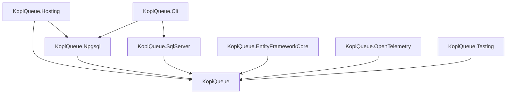
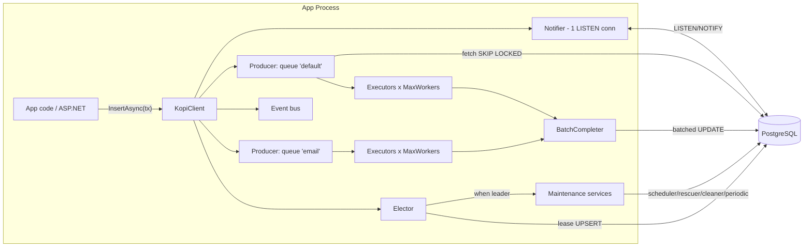
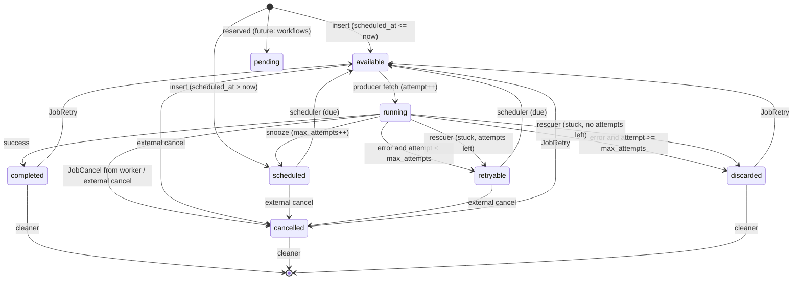

# KopiQueue — Technical Design

**Version:** 0.4 (draft) · **Date:** 2026-11-26 · **Related:** [Requirements](01-requirements.md), [Plan](03-plan.md)

---

## 1. Design principles

1. **The database is the coordinator.** All shared state, including leadership, lives in Postgres. Clients do not talk to each other except through LISTEN/NOTIFY, and notifications are only an optimisation: correctness never depends on them.
2. **Transactions are first-class.** Every operation that writes has a form that runs on a connection or transaction the caller owns.
3. **Small, set-based SQL.** Fetching, completing and maintenance are each one statement working on a batch.
4. **Bounded everything.** Batches, channels, retries and timeouts all have limits. Nothing grows without bound.
5. **Idiomatic .NET.** DI, Options, `ILogger`, `CancellationToken`, `IAsyncDisposable`, `System.Threading.Channels`.
6. **Pluggable at clear seams.** These parts can be replaced: driver, serializer, retry policy, middleware, error handler, clock. Everything else is internal.

## 2. Package layout

```
KopiQueue                      Core: client, options, job model, producers, executor, completer,
                               elector, maintenance, migrations runner, abstractions.
                               Depends on: Microsoft.Extensions.{DI,Logging,Options,Hosting}.Abstractions
KopiQueue.Npgsql               PostgreSQL driver (NpgsqlDataSource, COPY, LISTEN/NOTIFY). River-compatible schema.
KopiQueue.SqlServer            SQL Server / Azure SQL driver (Microsoft.Data.SqlClient, batched OPENJSON). Native KQ schema.
KopiQueue.Hosting              AddKopiQueue(), IHostedService, IConfiguration binding, health checks.
KopiQueue.EntityFrameworkCore  InsertAsync(DbContext ...), commit interceptor (local wake-up), migration helper.
                               Provider-neutral: picks the driver from the DbContext's connection type.
KopiQueue.OpenTelemetry        AddKopiQueueInstrumentation() for TracerProvider/MeterProvider.
KopiQueue.Testing              Assertions, TestWorker harness, fake insert client.
KopiQueue.Cli (dotnet tool)    `kopi migrate ... --provider postgres|sqlserver`, `kopi bench`, `kopi validate`.
```

Why split Hosting from Core: a console app or an Azure Function that only inserts jobs should not need `Microsoft.Extensions.Hosting`.
Users install `KopiQueue.Hosting` plus exactly one driver package (`KopiQueue.Npgsql` or `KopiQueue.SqlServer`).
`KopiQueue.EntityFrameworkCore` references only the core. It finds the driver at runtime from the registered client,
so it does not drag in both database clients.

### Dependency graph



## 3. Runtime architecture



### 3.1 Components

| Component | Responsibility | Req |
|-----------|----------------|-----|
| **KopiClient** | Public entry point. Insert/admin API. Owns the lifecycle (`StartAsync`/`StopAsync`) of every component below | FR-INS, FR-ADM, FR-HST |
| **Producer** (one per queue) | Decides when to fetch, fetches up to the number of free slots, sends jobs to executors, reacts to pause/resume/cancel | FR-EXE-01..04, FR-QUE-03 |
| **Executor** | Runs one job: DI scope, deserialise args, middleware pipeline, timeout, result classification | FR-EXE-05..09, FR-ERR |
| **BatchCompleter** | Collects job outcomes and writes them in batches (by size or every 50 ms). Applies back-pressure when saturated | FR-EXE-06 |
| **Notifier** | PostgreSQL: one dedicated **non-pooled** connection (`Pooling=false`, `Keepalive=5`; a pool reset silently drops LISTEN) with `LISTEN` on the insert, control and leadership channels. Fans messages out to subscribers. Reconnects with backoff (100 ms → 30 s, jitter) and, after every (re)connect, **wakes all producers and the elector**, because notifications sent while it was down are lost. Disposes a broken connection in the background with a timeout (spike 0.7). SQL Server: none (poll-only) | FR-EXE-03, FR-INS-07 |
| **LocalWaker** | In-process signal from the inserter to the producers of the same client, sent after the commit is known. Works with every driver. It is the only low-latency path on SQL Server | FR-DB-04 |
| **Elector** | Holds the leader lease. Starts and stops maintenance services on gaining and losing leadership | FR-MNT-01 |
| **Maintenance services** | Scheduler, Rescuer, Cleaner, QueueCleaner, PeriodicEnqueuer, Reindexer. Run only on the leader | FR-MNT, FR-PER, FR-SCH |
| **QueueMaintainer** (every client) | Upserts the queue row (`updated_at`) for each configured queue on an interval, and polls `paused_at` | FR-QUE-02/04 |
| **Event bus** | Bounded in-process channels for subscribers. Never blocks the completer: slow subscribers lose events and a counter records the drop | FR-OBS-01 |
| **Driver** | All SQL and connection handling. Exposes typed operations, so the core never builds SQL | NFR-OPS-01 |

### 3.2 Service lifecycle

Every internal component implements an internal `IStartStopService`:

```csharp
internal interface IStartStopService
{
    Task StartAsync(CancellationToken ct);   // returns once the component is running
    Task StopAsync(CancellationToken ct);    // stops; ct tells it to hurry up
}
```

Each runs a single long-lived loop on `Task.Run`, with its own `CancellationTokenSource`.
The client starts them in this order: notifier → elector → queue maintainer → completer → producers.
It stops them in reverse order. The completer is stopped last among the execution components, so that every result is flushed.

## 4. Data model

> **PostgreSQL (River-compatible, OQ-1 decided):** the table names and columns below MUST match River's schema at the pinned version: **migration line `main`, version 8, as created by River v0.51.2**.
> The exact shape was taken in [spike 0.8](spikes/0.8-river-schema-and-unique-keys.md), which introspects a database migrated by River's own CLI. Since task 1.2, CI checks it on every supported PostgreSQL version: after each version of the main line, up and down, KQ's catalog must equal River's (§4.1.1).
> The prefix is configurable: `river_` (default, compatible) or `kopi_` (no compatibility).
> **SQL Server:** KQ's own schema with the same logical model, see §4.4.

### 4.1 Tables (PostgreSQL)

```sql
CREATE TYPE river_job_state AS ENUM (
  'available', 'cancelled', 'completed', 'discarded',
  'pending', 'retryable', 'running', 'scheduled'
);

CREATE TABLE river_job (
  id            bigserial PRIMARY KEY,
  state         river_job_state NOT NULL DEFAULT 'available',
  attempt       smallint        NOT NULL DEFAULT 0,
  max_attempts  smallint        NOT NULL DEFAULT 25,
  attempted_at  timestamptz,
  created_at    timestamptz     NOT NULL DEFAULT now(),
  finalized_at  timestamptz,
  scheduled_at  timestamptz     NOT NULL DEFAULT now(),
  priority      smallint        NOT NULL DEFAULT 1,
  args          jsonb           NOT NULL,
  attempted_by  text[],
  errors        jsonb[],
  kind          text            NOT NULL,
  metadata      jsonb           NOT NULL DEFAULT '{}',
  queue         text            NOT NULL DEFAULT 'default',
  tags          varchar(255)[]  NOT NULL DEFAULT '{}',
  unique_key    bytea,
  unique_states bit(8),

  CONSTRAINT finalized_or_finalized_at_null CHECK (
    (finalized_at IS NULL AND state NOT IN ('cancelled','completed','discarded')) OR
    (finalized_at IS NOT NULL AND state IN ('cancelled','completed','discarded'))),
  CONSTRAINT max_attempts_is_positive CHECK (max_attempts > 0),
  CONSTRAINT priority_in_range        CHECK (priority BETWEEN 1 AND 4),
  CONSTRAINT queue_length             CHECK (char_length(queue) > 0 AND char_length(queue) < 128),
  CONSTRAINT kind_length              CHECK (char_length(kind)  > 0 AND char_length(kind)  < 128)
);

-- Fetching: the hot path
CREATE INDEX river_job_prioritized_fetching_index
  ON river_job (state, queue, priority, scheduled_at, id);
-- Cleaner
CREATE INDEX river_job_state_and_finalized_at_index
  ON river_job (state, finalized_at) WHERE finalized_at IS NOT NULL;
CREATE INDEX river_job_kind      ON river_job (kind);
CREATE INDEX river_job_args_index     ON river_job USING gin (args);
CREATE INDEX river_job_metadata_index ON river_job USING gin (metadata);

-- Uniqueness, enforced only while the job is in one of its unique_states
CREATE FUNCTION river_job_state_in_bitmask(bitmask bit(8), state river_job_state)
RETURNS boolean LANGUAGE sql IMMUTABLE AS $$ ... $$;   -- maps state → bit position
CREATE UNIQUE INDEX river_job_unique_idx ON river_job (unique_key)
  WHERE unique_key IS NOT NULL AND unique_states IS NOT NULL
    AND river_job_state_in_bitmask(unique_states, state);

CREATE UNLOGGED TABLE river_leader (
  name       text PRIMARY KEY DEFAULT 'default' CHECK (name = 'default'),
  leader_id  text NOT NULL CONSTRAINT leader_id_length CHECK (char_length(leader_id) > 0 AND char_length(leader_id) < 128),
  elected_at timestamptz NOT NULL,
  expires_at timestamptz NOT NULL
);

CREATE TABLE river_queue (
  name       text PRIMARY KEY,
  created_at timestamptz NOT NULL DEFAULT now(),
  updated_at timestamptz NOT NULL DEFAULT CURRENT_TIMESTAMP,
  paused_at  timestamptz,
  metadata   jsonb NOT NULL DEFAULT '{}'
);

CREATE TABLE river_migration (
  line       text   NOT NULL CONSTRAINT line_length CHECK (char_length(line) > 0 AND char_length(line) < 128),
  version    bigint NOT NULL CONSTRAINT version_gte_1 CHECK (version >= 1),
  created_at timestamptz NOT NULL DEFAULT now(),
  CONSTRAINT river_migration_pkey1 PRIMARY KEY (line, version)   -- "pkey1" is River's name from version 5 on
);

-- Notification outbox for drivers without LISTEN/NOTIFY. Part of the pinned schema; unused by KQ on PostgreSQL
CREATE TABLE river_notification (
  id         bigserial   PRIMARY KEY,
  created_at timestamptz NOT NULL DEFAULT now(),
  topic      text        NOT NULL CONSTRAINT topic_length CHECK (length(topic) > 0 AND length(topic) < 128),
  payload    text        NOT NULL
);
CREATE INDEX river_notification_created_at_idx ON river_notification (created_at);
CREATE INDEX river_notification_topic_id_idx   ON river_notification (topic, id);
```

The DDL above is a summary. The authoritative definition is the migration SQL in `src/KopiQueue.Npgsql/Migrations/main/`, whose result is compared with River's catalog in CI (§4.1.1): every name, column order, type, default, constraint, index and function signature is identical. For example, `river_leader`'s columns are in the order `elected_at, expires_at, leader_id, name`. The names are kept identical so that later River migrations, which may refer to them, apply cleanly.

Design notes:

- KQ's migrator creates exactly the pinned objects, including `river_notification`, and records versions 1–8 in `river_migration` (line `main`). A later `river migrate-up` from River's CLI then continues from a consistent state.
- `river_leader` is `UNLOGGED`. Losing its data on a crash is fine because leadership is re-elected, and an unlogged table avoids WAL writes for frequent lease renewals.
- `errors jsonb[]` holds one element per failed attempt: `{ "at", "attempt", "error", "trace" }`. The size is capped and the trace truncated (NFR-SEC-03).
- `attempted_by` is capped at the last N client IDs so the row does not grow without bound.
- `metadata` holds internal keys under reserved names, for example `cancel_attempted_at`, `snoozes` and `traceparent`. User keys are free-form.

#### 4.1.1 The main line, version by version (plan task 1.2)

KQ ships all eight versions, not just the final schema, so that it can continue a database River migrated part of the way, and River can continue one KQ migrated. Each version was written clean-room from black-box observation of River v0.51.2's CLI: migrate a scratch schema one version at a time, read its catalog (shape only, no function bodies), and probe how each step treats existing rows.

| Version | Up | Down |
|---------|----|------|
| 1 | `river_migration` in its original shape: `id bigserial`, `created_at`, `version` (unique, `CHECK version >= 1`) | Drop it |
| 2 | `river_job_state` (7 values), `river_job` with its indexes, `river_leader` (UNLOGGED), and an `AFTER INSERT` trigger that calls `pg_notify('river_insert', '{"queue" : "<queue>"}')` for rows inserted as `available` | Drop them |
| 3 | `tags`: NULLs become `{}`, then `DEFAULT '{}' NOT NULL` | Drop the default and NOT NULL |
| 4 | Add enum value `pending`; NULL `args` and `metadata` become `{}`, then NOT NULL; stricter `finalized_or_finalized_at_null`; drop the trigger; add `river_queue`; `river_leader.name` gets `DEFAULT 'default'` and `CHECK (name = 'default')` (fails while a row has another name) | Reverse everything **except** the `pending` value, and also make `metadata` nullable without a default: River's own down leaves that state |
| 5 | Replace the migration table with `(line, version, created_at)`, copying rows as line `main` with their timestamps; add `unique_key` and the unique index on `(kind, unique_key)`; add UNLOGGED `river_client` and `river_client_queue` | Refuse while other lines are recorded; otherwise restore the original table and drop the rest |
| 6 | Add `unique_states bit(8)`, `river_job_state_in_bitmask` and `river_job_unique_idx`; drop the `(kind, unique_key)` index. Existing rows are not backfilled | Reverse; recreating the old index fails while two rows share `(kind, unique_key)` |
| 7 | Drop `river_client*`; add `river_notification`; `max_attempts DEFAULT 25`; `river_queue.updated_at DEFAULT CURRENT_TIMESTAMP` | Reverse |
| 8 | Nothing on PostgreSQL: the catalog is identical before and after it (in River the version matters for other databases) | Nothing |

- **Migration table shapes.** Versions 1–4 use the original table, which can only record the `main` line. The driver detects the shape each time it reads or writes a version, so any other line needs `main` at version 5 or later.
- **Bitmask function.** `river_job_state_in_bitmask(bitmask, state)` returns the bit for `state`. From left to right the bits are scheduled, running, retryable, pending, discarded, completed, cancelled, available. A NULL bitmask gives NULL and a NULL state gives false. Tests check all 2,048 inputs against River's function.
- **Goldens and checks.** `tests/KopiQueue.Npgsql.Tests/Migrations/River/v0.51.2/` holds River's catalog after each up version, plus the two down states that differ (versions 2 and 3). The tests compare KQ against them at every version, up and down. With `KOPI_RIVER_CLI` set (always in CI), they also check that River's CLI still produces the goldens, that KQ continues a schema River migrated to version 4, that River continues and reverts a schema KQ migrated, and that `river validate` passes. Set `KOPI_RIVER_GOLDEN_DIR` to regenerate the goldens for a new pinned version.
- **Prefix.** With another prefix, for example `kopi_`, the same objects are created with that prefix and can coexist with `river_` objects in one schema. Trigger, channel and column names that are fixed in River (for example `river_insert` and `river_client_id`) stay as they are.

### 4.2 Job state machine



Invariant (DB-enforced): `finalized_at IS NOT NULL ⇔ state ∈ {completed, cancelled, discarded}`.

### 4.3 Notification channels

| Channel | Payload (JSON) | Sender | Consumer |
|---------|----------------|--------|----------|
| `"<schema>.river_insert"` | `{"queue":"email"}` | Inserter (inside the caller's tx, via `pg_notify`), scheduler | Producer for that queue → fetch now |
| `"<schema>.river_control"` | `{"action":"cancel","job_id":123,"queue":"email"}` / `{"action":"pause"\|"resume","queue":"*"\|"email"}` | Admin API | Producers |
| `"<schema>.river_leadership"` | `{"action":"resigned","leader_id":"..."}` | Elector | Electors → try to win immediately |

Channel rules (spikes 0.7 and 0.8):

- Channels are **schema-qualified** (River uses `public.river_insert` for the default schema) and are always **quoted** in `LISTEN`. Unquoted, the dot is a syntax error.
- `LISTEN` silently truncates names over 63 bytes, while `pg_notify` rejects them. With notifications enabled, the schema name must therefore be **≤ 46 bytes**; this is validated at startup.
- Payloads are parsed as JSON, never compared as strings: River sends jsonb text such as `{"queue": "default"}`. The limit is 7,999 bytes.
- Commit-to-delivery latency was p50 0.22 ms locally. Postgres collapses identical channel + payload pairs within one transaction, and delivers nothing on rollback or for a rolled-back savepoint.

Because `pg_notify` is called inside the caller's transaction, Postgres delivers the notification only on commit. This satisfies FR-INS-07 for free.
Insert notifications are **debounced** per queue: at most one per queue per transaction, and producers coalesce wake-ups within the fetch cooldown.

On SQL Server none of these channels exist. Each one is replaced as follows (FR-DB-04/05):

| PostgreSQL channel | SQL Server replacement |
|--------------------|------------------------|
| `river_insert` | LocalWaker for inserts from the same process, plus the producer poll (`FetchPollInterval`, default 1 s, minimum 100 ms) |
| `river_control` cancel | Producers poll `cancel_attempted_at` for their running job ids on every fetch cycle (design §5.8 step 4) |
| `river_control` pause/resume | QueueMaintainer polls `kopi_queue.paused_at` (default every 1 s on SQL Server) |
| `river_leadership` resigned | Electors retry at the normal elect interval. A graceful resign deletes the row, so the next attempt wins at once |

### 4.4 Tables (SQL Server)

Same logical model as §4.1. Mapping:

| Concept | PostgreSQL | SQL Server |
|---------|------------|------------|
| Job id | `bigserial` | `bigint IDENTITY`, clustered PK |
| State | enum `river_job_state` | `varchar(16)` + `CHECK (state IN (...))` |
| Timestamps | `timestamptz` | `datetime2(6)` holding **UTC**, set with `SYSUTCDATETIME()` |
| args / metadata | `jsonb` | `nvarchar(max)` + `CHECK (ISJSON(x) = 1)`. Native `json` on SQL Server 2025 / Azure SQL behind a feature check (OQ-7) |
| tags / attempted_by / errors | arrays | `nvarchar(max)` holding a JSON array |
| unique_states | `bit(8)` | `tinyint` bitmask (same bit mapping in code for both drivers) |
| Leader table | `UNLOGGED` | Ordinary table. One row, written every 5 s, so write cost is negligible |
| GIN indexes on args/metadata | yes | none. Admin filters on JSON content scan the table; documented |

```sql
CREATE TABLE kopi_job (
  id            bigint IDENTITY(1,1) NOT NULL CONSTRAINT kopi_job_pk PRIMARY KEY CLUSTERED,
  state         varchar(16)    NOT NULL CONSTRAINT kopi_job_state_df DEFAULT 'available',
  attempt       smallint       NOT NULL DEFAULT 0,
  max_attempts  smallint       NOT NULL,
  attempted_at  datetime2(6)   NULL,
  created_at    datetime2(6)   NOT NULL DEFAULT SYSUTCDATETIME(),
  finalized_at  datetime2(6)   NULL,
  scheduled_at  datetime2(6)   NOT NULL DEFAULT SYSUTCDATETIME(),
  priority      smallint       NOT NULL DEFAULT 1,
  args          nvarchar(max)  NOT NULL,
  attempted_by  nvarchar(max)  NULL,
  errors        nvarchar(max)  NULL,
  kind          nvarchar(128)  NOT NULL,
  metadata      nvarchar(max)  NOT NULL DEFAULT N'{}',
  queue         nvarchar(128)  NOT NULL DEFAULT N'default',
  tags          nvarchar(max)  NOT NULL DEFAULT N'[]',
  unique_key    varbinary(32)  NULL,
  unique_states tinyint        NULL,
  -- 0 while the job "occupies" its unique slot, otherwise its own id (see ADR-011)
  unique_slot AS CAST(CASE
      WHEN unique_key IS NOT NULL AND unique_states IS NOT NULL
       AND (unique_states & CASE state
             WHEN 'available' THEN 1   WHEN 'cancelled' THEN 2  WHEN 'completed' THEN 4
             WHEN 'discarded' THEN 8   WHEN 'pending'   THEN 16 WHEN 'retryable' THEN 32
             WHEN 'running'   THEN 64  WHEN 'scheduled' THEN 128 END) <> 0
      THEN 0 ELSE id END AS bigint) PERSISTED,

  CONSTRAINT kopi_job_state_valid CHECK (state IN
    ('available','cancelled','completed','discarded','pending','retryable','running','scheduled')),
  CONSTRAINT kopi_job_finalized_or_finalized_at_null CHECK (
    (finalized_at IS NULL     AND state NOT IN ('cancelled','completed','discarded')) OR
    (finalized_at IS NOT NULL AND state     IN ('cancelled','completed','discarded'))),
  CONSTRAINT kopi_job_max_attempts_is_positive CHECK (max_attempts > 0),
  CONSTRAINT kopi_job_priority_in_range        CHECK (priority BETWEEN 1 AND 4),
  CONSTRAINT kopi_job_queue_length CHECK (LEN(queue) BETWEEN 1 AND 128),
  CONSTRAINT kopi_job_kind_length  CHECK (LEN(kind)  BETWEEN 1 AND 128),
  CONSTRAINT kopi_job_args_json     CHECK (ISJSON(args) = 1),
  CONSTRAINT kopi_job_metadata_json CHECK (ISJSON(metadata) = 1)
);

-- Hot fetch path: filtered to available rows only, so it stays small
CREATE INDEX kopi_job_fetch_idx     ON kopi_job (queue, priority, scheduled_at, id) WHERE state = 'available';
-- Scheduler
CREATE INDEX kopi_job_schedule_idx  ON kopi_job (scheduled_at) INCLUDE (queue) WHERE state IN ('scheduled','retryable');
-- Rescuer
CREATE INDEX kopi_job_running_idx   ON kopi_job (attempted_at) WHERE state = 'running';
-- Cleaner
CREATE INDEX kopi_job_finalized_idx ON kopi_job (state, finalized_at) WHERE finalized_at IS NOT NULL;
CREATE INDEX kopi_job_kind_idx      ON kopi_job (kind);
-- Uniqueness (no filter needed: rows outside their unique states get unique_slot = id)
CREATE UNIQUE INDEX kopi_job_unique_idx ON kopi_job (unique_key, unique_slot);

CREATE TABLE kopi_leader (
  name       varchar(16)   NOT NULL CONSTRAINT kopi_leader_pk PRIMARY KEY DEFAULT 'default' CHECK (name = 'default'),
  leader_id  nvarchar(128) NOT NULL,
  elected_at datetime2(6)  NOT NULL,
  expires_at datetime2(6)  NOT NULL
);

CREATE TABLE kopi_queue (
  name       nvarchar(128) NOT NULL CONSTRAINT kopi_queue_pk PRIMARY KEY,
  created_at datetime2(6)  NOT NULL DEFAULT SYSUTCDATETIME(),
  updated_at datetime2(6)  NOT NULL,
  paused_at  datetime2(6)  NULL,
  metadata   nvarchar(max) NOT NULL DEFAULT N'{}' CHECK (ISJSON(metadata) = 1)
);

CREATE TABLE kopi_migration (
  line       nvarchar(128) NOT NULL,
  version    bigint        NOT NULL,
  created_at datetime2(6)  NOT NULL DEFAULT SYSUTCDATETIME(),
  CONSTRAINT kopi_migration_pk PRIMARY KEY (line, version)
);
```

SQL Server notes:

- Filtered indexes and indexed computed columns need `ANSI_NULLS`, `QUOTED_IDENTIFIER`, `ANSI_PADDING`, `ANSI_WARNINGS`, `ARITHABORT` and `CONCAT_NULL_YIELDS_NULL` ON, and `NUMERIC_ROUNDABORT` OFF, in every session that writes the table. SqlClient's defaults satisfy this, with one subtlety verified in M0: SqlClient leaves `ARITHABORT` **OFF**, but at compatibility level ≥ 90 `ANSI_WARNINGS ON` implies it. The driver checks the options on first use and fails fast if a session (for example one opened by other code with `SET ANSI_WARNINGS OFF`) would break writes.
- Every batch statement stays below 5,000 rows (the lock-escalation threshold), so row locks never escalate to a table lock while producers fetch.
- The schema (default `dbo`) and the prefix are substituted into the SQL after validation and quoted with `QUOTENAME` rules.

## 5. Key algorithms

### 5.1 Fetch (producer)

```sql
WITH locked AS (
  SELECT id FROM river_job
  WHERE state = 'available' AND queue = @queue AND scheduled_at <= now()
  ORDER BY priority, scheduled_at, id
  LIMIT @limit
  FOR UPDATE SKIP LOCKED
)
UPDATE river_job j
SET state        = 'running',
    attempt      = j.attempt + 1,
    attempted_at = now(),
    attempted_by = (j.attempted_by || @client_id::text)[greatest(1, cardinality(j.attempted_by) - 99):]
FROM locked
WHERE j.id = locked.id
RETURNING j.*;
```

Producer loop (pseudo):

```
loop:
  wait until (insert notification for my queue) OR (poll timer, default 1 s) OR stop
  if paused: continue
  wait out the fetch cooldown (default 100 ms) since the last fetch   // coalesces bursts
  free = MaxWorkers - running
  if free == 0: continue            // woken again when an executor finishes
  jobs = Fetch(limit = min(free, FetchBatchMax))
  for job in jobs: start Executor(job) on a slot
  if jobs.Count == limit: schedule an immediate refetch (more work is likely)
```

Concurrency control: a `SemaphoreSlim(MaxWorkers)` per producer. A slot is released after the completer has *accepted* the result, not after it has been written to the database. This keeps the semaphore from blocking on database writes.

### 5.2 Execute (executor)

```
using scope = services.CreateAsyncScope()
args   = serializer.Deserialize(job.Args, registry.TypeFor(job.Kind))       // NFR-SEC-02
worker = scope.Resolve<IWorker<TArgs>>()
timeout = worker.Timeout(job) ?? options.JobTimeout                          // default 1 min
using cts = CreateLinkedTokenSource(clientHardStopToken, jobCancelToken)
cts.CancelAfter(timeout)
try   await pipeline(middlewares..., worker.WorkAsync)(job, cts.Token)
      → Completed
catch JobCancelException     → Cancelled (reason recorded in errors)
catch JobSnoozeException(d)  → Snoozed(d)
catch OperationCanceledException when the timeout fired → Error(timeout)
catch Exception e            → errorHandler?.HandleError(job, e) may override; else Error(e)
outcome → completer.Enqueue(job.Id, outcome)
```

Job control from workers uses exceptions, the idiomatic .NET way to unwind. Static helpers make the code read naturally:

```csharp
throw JobControl.Cancel("customer deleted");
throw JobControl.Snooze(TimeSpan.FromMinutes(5));
```

Classifying outcomes into states:

| Outcome | New state | Fields |
|---------|-----------|--------|
| Completed | `completed` | `finalized_at = now()` |
| Error, attempt < max | `retryable` | `scheduled_at = now() + NextRetry(job)`, append to `errors` |
| Error, attempt ≥ max | `discarded` | `finalized_at = now()`, append to `errors` |
| Cancel | `cancelled` | `finalized_at = now()`, append to `errors` |
| Snooze(d) | `scheduled` (or `available` if d = 0) | `scheduled_at = now() + d`, `max_attempts = max_attempts + 1`, `metadata.snoozes++` |

### 5.3 Batch complete

```sql
UPDATE river_job j
SET state        = u.state,
    finalized_at = u.finalized_at,
    scheduled_at = coalesce(u.scheduled_at, j.scheduled_at),
    max_attempts = coalesce(u.max_attempts, j.max_attempts),
    errors       = CASE WHEN u.error IS NULL THEN j.errors ELSE array_append(j.errors, u.error) END,
    metadata     = j.metadata || coalesce(u.metadata_patch, '{}')
FROM unnest(@ids, @states, @finalized_at, @scheduled_at, @max_attempts, @errors, @metadata_patch)
     AS u(id, state, finalized_at, scheduled_at, max_attempts, error, metadata_patch)
WHERE j.id = u.id
  AND j.state = 'running'            -- guard: don't clobber a concurrent rescue or delete
RETURNING j.*;
```

- Flushed when the batch reaches 2,000 rows or 50 ms have passed, whichever comes first.
- If a job was cancelled from outside while running (`metadata.cancel_attempted_at` is set) and the worker then returned an error, the outcome becomes `cancelled`, not `retryable`.
- When the database is unavailable, the completer retries with backoff. Its bounded input channel fills, which naturally slows the producers down (back-pressure).
- Events are published only after the batch commits (NFR-REL-03).

Completer variants (option): `Batch` (default), `Async` (one update per job, run in parallel), and `Inline` (synchronous, mainly for tests).

### 5.4 Retry policy

```csharp
public interface IRetryPolicy { DateTimeOffset NextRetry(JobRow job, DateTimeOffset now); }

// Default: attempt^4 seconds, ±10% jitter, capped at 24 h.
// attempt 1 → 1 s, 2 → 16 s, 3 → 81 s, 5 → ~10 min, 10 → ~2.8 h, 25 → capped.
```

The worker's `NextRetry(job)` override wins over the client policy.

### 5.5 Leader election

```sql
-- Try to win (every ElectInterval, default 5 s, when not leader)
INSERT INTO river_leader (leader_id, elected_at, expires_at)
VALUES (@id, now(), now() + @ttl)
ON CONFLICT (name) DO UPDATE
  SET leader_id = EXCLUDED.leader_id, elected_at = EXCLUDED.elected_at, expires_at = EXCLUDED.expires_at
  WHERE river_leader.expires_at < now()
RETURNING leader_id = @id AS won;

-- Renew (every ElectInterval when leader). 0 rows ⇒ lost leadership
UPDATE river_leader SET expires_at = now() + @ttl WHERE leader_id = @id;

-- Resign (graceful stop)
DELETE FROM river_leader WHERE leader_id = @id;  then NOTIFY river_leadership
```

- The TTL (default 15 s) is larger than ElectInterval (5 s) plus jitter, so one slow renewal does not cost leadership.
- If a renewal fails, the leader stops maintenance services **before** its lease expires (a safety margin of TTL/3). Maintenance must also be safe when two leaders briefly overlap: every maintenance statement is idempotent and uses `SKIP LOCKED`.

### 5.6 Unique jobs

- **Unique key** (reconstructed black-box in spike 0.8; reproduces 22 of 22 River v0.51.2 golden vectors): `SHA-256` over the concatenation of the enabled parts, in this order:
  - `&kind=<kind>`, unless `ExcludeKind` is set;
  - `&args=<canonical args>` (`ByArgs`);
  - `&period=<floor(now / period) * period as RFC 3339 UTC, seconds, "Z">` (`ByPeriod`);
  - `&queue=<queue>` (`ByQueue`).
- **Canonical args:** the top-level members of the serialised args, restricted to properties marked `[UniqueKey]` if the type has any. They are sorted bytewise by name, and each value's JSON text is copied **verbatim**; nested objects are not re-sorted. The state set and the period length are **not** part of the key.
- Because values are copied verbatim, cross-language deduplication with Go producers needs Go-compatible JSON escaping (DQ-8).
- `unique_states` is a bitmask of the states in which the key "occupies" the slot. The partial unique index enforces it only while the row's current state is in the mask. The bit order in `bit(8)` text, left to right, is `scheduled, running, retryable, pending, discarded, completed, cancelled, available`, so as an integer available = 1 and scheduled = 128, exactly as in the SQL Server `tinyint`. The default is `11110101`.
- Insert:

```sql
INSERT INTO river_job (...) VALUES (...)
ON CONFLICT (unique_key)
  WHERE unique_key IS NOT NULL AND unique_states IS NOT NULL
        AND river_job_state_in_bitmask(unique_states, state)
DO UPDATE SET kind = EXCLUDED.kind              -- no-op update, so RETURNING gives the existing row
RETURNING *, (xmax <> 0) AS unique_skipped_as_duplicate;
```

- A job leaving the "occupied" states, for example to `discarded`, frees the slot automatically because the partial index no longer covers it.

### 5.7 Maintenance services (leader only)

| Service | Interval (default) | Statement sketch | Batch |
|---------|--------------------|------------------|-------|
| Scheduler | 5 s | `UPDATE ... SET state='available' WHERE state IN ('scheduled','retryable') AND scheduled_at <= now() ... SKIP LOCKED`, then one `river_insert` notify per affected queue | 10,000 |
| Rescuer | 1 min | Select `running` jobs with `attempted_at < now() - RescueStuckJobsAfter` (default JobTimeout + 1 h). Retry with backoff or discard; append a "stuck" error | 1,000 |
| Job cleaner | 30 s | `DELETE` finalised jobs past their retention, by state, via `ctid` with `SKIP LOCKED` | 1,000 |
| Queue cleaner | 1 min | `DELETE FROM river_queue WHERE updated_at < now() - 24h` | 1,000 |
| Periodic enqueuer | dynamic (next tick) | Computes the next run for each periodic job and inserts it as unique by `(kind, period=tick)` | n/a |
| Reindexer (opt-in) | daily | `REINDEX INDEX CONCURRENTLY` on the args/metadata GIN indexes | n/a |

Each service loops: run one batch, and if the batch was full, run again at once; otherwise sleep for the interval, with ±10% jitter.

### 5.8 Cancellation of a running job across clients

1. `JobCancelAsync(id)` runs an `UPDATE` in one statement: if the job is not running, set it to `cancelled` and finalise it. If it is running, set `metadata.cancel_attempted_at = now()` only. Then `pg_notify('river_control', {action: cancel, job_id, queue})`.
2. Every producer for that queue receives the notification. The one running that job cancels the job's `CancellationTokenSource`.
3. The worker observes the cancellation. The completer sees `cancel_attempted_at` and finalises the job as `cancelled`.
4. Poll-only mode: producers also check `cancel_attempted_at` for their running jobs on each poll. This is a cheap query by id list.

### 5.9 Graceful shutdown

```
StopAsync(ct):           // host shutdown, default HostOptions.ShutdownTimeout = 30 s
  1. producers: stop fetching; unsubscribe from notifications
  2. wait for running jobs                          ── soft stop
  3. if ct fires (or SoftStopTimeout): cancel every job token   ── hard stop
     wait up to HardStopGrace (default 5 s) for workers to unwind
  4. completer: flush everything that is pending
  5. elector: resign + notify
  6. notifier: UNLISTEN + close
Jobs still running after the hard stop stay in `running` and are later rescued (at-least-once).
```

## 6. Public API (sketch)

### 6.1 Defining jobs and workers

```csharp
[JobKind("send_email")]                      // stable kind string; see ADR-003
public sealed record SendEmailArgs(string To, string TemplateId, [property: UniqueKey] Guid OrderId) : IJobArgs;

public sealed class SendEmailWorker(IEmailSender sender, ILogger<SendEmailWorker> log)
    : Worker<SendEmailArgs>
{
    public override TimeSpan? Timeout(Job<SendEmailArgs> job) => TimeSpan.FromSeconds(30);

    public override async Task WorkAsync(Job<SendEmailArgs> job, CancellationToken ct)
    {
        if (job.Attempt > 3 && await sender.IsSuppressedAsync(job.Args.To, ct))
            throw JobControl.Cancel("recipient suppressed");

        await sender.SendAsync(job.Args.To, job.Args.TemplateId, ct);
    }
}
```

`Job<TArgs>` exposes `Id, Args, Kind, Queue, Attempt, MaxAttempts, Priority, Tags, Metadata, CreatedAt, ScheduledAt, AttemptedAt, Errors`.

### 6.2 Registration

```csharp
builder.Services.AddNpgsqlDataSource(builder.Configuration.GetConnectionString("Db")!);

builder.Services.AddKopiQueue(kq =>
{
    kq.UseNpgsql();                                  // resolves NpgsqlDataSource from DI
    // or: kq.UseSqlServer(builder.Configuration.GetConnectionString("Sql")!);
    kq.AddQueue("default", maxWorkers: 50);
    kq.AddQueue("email",   maxWorkers: 10);
    kq.AddWorker<SendEmailWorker>();                 // or kq.AddWorkersFromAssembly(...)
    kq.AddPeriodicJob(Cron.Parse("0 2 * * *"), () => new RebuildIndexArgs(),
                      o => o.RunOnStart = false);
    kq.UseJsonContext(AppJsonContext.Default);       // AOT/trim-friendly args serialization
})
.BindConfiguration("KopiQueue");                     // appsettings: queues, timeouts, retention
```

### 6.3 Inserting

```csharp
public interface IKopiClient
{
    Task<InsertResult<TArgs>> InsertAsync<TArgs>(TArgs args, InsertOptions? opts = null, CancellationToken ct = default) where TArgs : IJobArgs;
    Task<InsertResult<TArgs>> InsertAsync<TArgs>(TArgs args, DbTransaction tx, InsertOptions? opts = null, CancellationToken ct = default) where TArgs : IJobArgs;
    Task<IReadOnlyList<InsertResult>> InsertManyAsync(IEnumerable<InsertRequest> jobs, DbTransaction? tx = null, CancellationToken ct = default);
    Task<long> InsertManyFastAsync(IEnumerable<InsertRequest> jobs, DbTransaction? tx = null, CancellationToken ct = default); // COPY

    Task<JobRow?> JobGetAsync(long id, CancellationToken ct = default);
    Task<JobListResult> JobListAsync(JobListParams p, CancellationToken ct = default);
    Task<JobRow> JobCancelAsync(long id, CancellationToken ct = default);
    Task<JobRow> JobRetryAsync(long id, CancellationToken ct = default);
    Task<JobRow?> JobDeleteAsync(long id, CancellationToken ct = default);

    Task QueuePauseAsync(string queue, CancellationToken ct = default);   // "*" = all queues
    Task QueueResumeAsync(string queue, CancellationToken ct = default);
    Task<QueueListResult> QueueListAsync(QueueListParams p, CancellationToken ct = default);

    IEventSubscription Subscribe(params EventKind[] kinds);               // ChannelReader<JobEvent>
}
```

```csharp
// Npgsql
await using var tx = await conn.BeginTransactionAsync(ct);
await orders.InsertAsync(order, tx, ct);
await kopi.InsertAsync(new SendEmailArgs(order.Email, "order-confirm", order.Id), tx,
    new InsertOptions { Queue = "email", Unique = new() { ByArgs = true, ByPeriod = TimeSpan.FromHours(1) } }, ct);
await tx.CommitAsync(ct);

// EF Core (KopiQueue.EntityFrameworkCore)
await using var tx = await db.Database.BeginTransactionAsync(ct);
db.Orders.Add(order);
await db.SaveChangesAsync(ct);
await kopi.InsertAsync(new SendEmailArgs(...), db, ct: ct);   // uses db's current connection/tx
await tx.CommitAsync(ct);
```

`InsertAsync` with a transaction requires the transaction type of the configured driver at runtime: `NpgsqlTransaction` or `SqlTransaction`. Any other type throws `ArgumentException`. We accept `DbTransaction` in the signature so the core takes no dependency on either database client.

With EF Core, the `KopiQueue.EntityFrameworkCore` package also registers a `DbTransactionInterceptor`. It sends the LocalWaker signal after `TransactionCommitted`, so EF inserts get low-latency pickup even on SQL Server. A raw `SqlTransaction` has no commit hook, so those jobs are picked up on the next poll.

### 6.4 Extensibility points

| Seam | Interface | Default |
|------|-----------|---------|
| Driver | `IKopiDriver` (marked `[Experimental]` until 2.0) | `NpgsqlDriver` |
| Args serialisation | `IJobArgsSerializer` | `System.Text.Json` + optional `JsonSerializerContext` |
| Retry | `IRetryPolicy` | `DefaultRetryPolicy` |
| Insert middleware | `IJobInsertMiddleware` | Tracing propagation (when OTel is on) |
| Worker middleware | `IWorkerMiddleware` (`InvokeAsync(JobContext, next, ct)`) | Logging scope, tracing, metrics |
| Errors | `IErrorHandler` (`HandleErrorAsync`, `HandlePanicAsync`) | Log only |
| Clock | `TimeProvider` | `TimeProvider.System` |

## 7. Configuration (defaults)

| Option | Default | Notes |
|--------|---------|-------|
| `ClientId` | `{machine}-{pid}-{random}` | Recorded in `attempted_by` and in the leader lease |
| `Schema` | `null` (search_path) | FR-MIG-05 |
| `TablePrefix` | `river_` (PostgreSQL) / `kopi_` (SQL Server) | OQ-1 |
| `Queues[name].MaxWorkers` | required | 1..10,000 |
| `FetchPollInterval` | 1 s | PostgreSQL: 5 s is recommended in poll-only mode. SQL Server: 1 s; 100 ms is safe (an empty poll costs about 3 logical reads, spike 0.10) |
| `FetchBatchMax` | 1,000 | Upper bound on rows per fetch. Hard limit of 2,000 on SQL Server, to stay below lock escalation (spike 0.9) |
| `FetchCooldown` | 100 ms | |
| `JobTimeout` | 1 min | `Timeout.InfiniteTimeSpan` allowed |
| `MaxAttempts` | 25 | |
| `RescueStuckJobsAfter` | JobTimeout + 1 h | |
| `CompletedJobRetention` / `Cancelled` / `Discarded` | 24 h / 24 h / 7 d | `null` = never delete |
| `ElectInterval` / `LeaderTtl` | 5 s / 15 s | |
| `SchedulerInterval` | 5 s | |
| `NotificationMode` | `Auto` | `Auto` \| `ListenNotify` \| `PollOnly`. SQL Server is always `PollOnly` (plus LocalWaker) |
| `NotifierConnectionString` | `null` (derived from the data source) | PostgreSQL: a direct connection for LISTEN when the data source goes through PgBouncer in transaction mode or a proxy. KQ always forces `Pooling=false` on it |
| `NotifierKeepAlive` | 5 s | Npgsql `Keepalive` on the notifier connection. A silently dead connection is detected after about 2× this value; without it, it is never detected (spike 0.7) |
| `SoftStopTimeout` | null (use host token) | |
| `CompleterMode` | `Batch` | `Batch` \| `Async` \| `Inline` |

All options are validated at startup with `IValidateOptions<KopiQueueOptions>`. Invalid configuration fails host startup.

## 8. Driver abstraction

```csharp
[Experimental("KQ0001")]
public interface IKopiDriver
{
    IKopiExecutor GetExecutor();                         // pooled connection
    IKopiExecutor GetExecutor(DbTransaction tx);         // caller's transaction
    IKopiListener? CreateListener();                      // null ⇒ poll-only (SQL Server)
    DriverCapabilities Capabilities { get; }              // ListenNotify, ReturningBulkInsert, NativeJson, ...
}

public interface IKopiExecutor   // typed operations; no SQL leaks to the core
{
    Task<JobRow> JobInsertAsync(JobInsertParams p, CancellationToken ct);
    Task<IReadOnlyList<JobRow>> JobInsertManyAsync(IReadOnlyList<JobInsertParams> p, CancellationToken ct);
    Task<long> JobInsertCopyAsync(IReadOnlyList<JobInsertParams> p, CancellationToken ct);
    Task<IReadOnlyList<JobRow>> JobFetchAsync(JobFetchParams p, CancellationToken ct);
    Task<IReadOnlyList<JobRow>> JobSetStateManyAsync(JobSetStateParams p, CancellationToken ct);
    Task<int> JobScheduleAsync(JobScheduleParams p, CancellationToken ct);
    Task<bool> LeaderAttemptElectAsync(LeaderElectParams p, CancellationToken ct);
    Task NotifyAsync(string channel, IReadOnlyList<string> payloads, CancellationToken ct);
    // ... ~35 operations in total, mirroring the needs of the components above
}
```

- SQL is kept as embedded `.sql` resources in the driver. Each is prepared once per connection (Npgsql auto-prepare) and checked by tests run against a real Postgres.
- The schema name and table prefix are substituted into the SQL at startup, after validation (NFR-SEC-01).
- `JobRow` is materialised with a hand-written `DbDataReader` mapping per driver: no reflection, so it is AOT-safe.
- The core never branches on the driver type. Differences are expressed through `DriverCapabilities`. For example, the producer turns off its notification subscription when `ListenNotify` is false.

**Migration engine (plan task 1.1).** The core owns loading, planning and running; each driver supplies a lock and step execution.

- Files: `Migrations/<line>/<NNN>_<name>.<up|down>.sql`, embedded with the logical name `kopi-migrations/<line>/...`. A line's versions run from 1 with no gaps, and every version needs both scripts. The loader rejects anything else at startup.
- Placeholders: write table names as `{{schema}}{{prefix}}job`. `{{schema}}` becomes the quoted schema plus a dot, or nothing when no schema is configured (the connection's `search_path` or default schema applies). An unknown placeholder is an error.
- Each script runs in its own transaction together with its version row. Up runs the SQL and then inserts the row; down deletes the row and then runs the SQL. A script whose leading comments contain `-- kopi:no-transaction` runs outside a transaction (for `CREATE INDEX CONCURRENTLY`). Such a script must hold a single statement, because PostgreSQL treats a multi-statement batch as an implicit transaction.
- Planning: up applies the missing versions up to the target (default: the latest). Down reverts down to the target (default: one step; `0` reverts the whole line). Recorded versions must form a gap-free 1..N. A database that is newer than the library is a no-op for up and an error for down.
- Lock: the runner polls `TryAcquireLock` every 200 ms until `LockTimeout` (default 30 s). PostgreSQL uses a session-level `pg_try_advisory_lock` whose key is the first 8 bytes of SHA-256(`kopi_migrate:<schema>.<prefix>`), so separate schemas migrate independently. SQL Server uses `sp_getapplock` (§8.1). River's CLI does not take this lock, so do not run both against the same schema at once.
- The migration table is created by version 1 of the `main` line, in River's original shape, and replaced by the `(line, version)` shape in version 5 (§4.1.1). The driver handles both, so `main` must reach version 5 before any other line is applied.
- A failed step is wrapped in `KopiQueueMigrationException` with the database error as the inner exception. Earlier steps stay applied.

### 8.1 SQL Server driver: algorithm variants

The Postgres SQL in §5 has these SQL Server equivalents. Fetch, complete, unique insert, bulk insert and polling were validated on SQL Server 2019 with RCSI both off and on, in spikes [0.9](spikes/0.9-sqlserver-fetch-and-locking.md) and [0.10](spikes/0.10-sqlserver-unique-bulk-poll.md). The statements below include the changes those spikes required.

**Rules for every SQL Server statement** (from spike 0.9):

1. A statement that uses `READPAST` starts with `SET TRANSACTION ISOLATION LEVEL READ COMMITTED;`. SNAPSHOT isolation **leaks through the SqlClient connection pool** and makes `READPAST` fail with error 650. The SET is scoped to the `sp_executesql` batch, so it never changes a session shared with application code.
2. The driver adds `Application Name=KopiQueue` to its connection string by default. KQ then has its own pool, and its sessions can be identified in DMVs.
3. Locking statements pin their access path with `FORCESEEK` (or an `INDEX` hint). Without it the fetch plan flips to a clustered scan at larger limits, and the scan escalates to a table X lock.
4. No statement touches more than **2,000 rows**. Each touched row takes one key lock per maintained index, and escalation fires once an index passes about 5,000 locks in a single statement.
5. Each such statement has a plan-shape test (seek, no escalation) in `KopiQueue.SqlServer.Tests`.

**Fetch** (`SKIP LOCKED` → `UPDLOCK, READPAST, ROWLOCK, FORCESEEK` on an updatable CTE):

```sql
SET TRANSACTION ISOLATION LEVEL READ COMMITTED;
WITH locked AS (
  SELECT TOP (@limit) *
  FROM kopi_job WITH (UPDLOCK, READPAST, ROWLOCK, FORCESEEK(kopi_job_fetch_idx(queue)))
  WHERE state = 'available' AND queue = @queue AND scheduled_at <= SYSUTCDATETIME()
  ORDER BY priority, scheduled_at, id
)
UPDATE locked
SET state        = 'running',
    attempt      = attempt + 1,
    attempted_at = SYSUTCDATETIME(),
    attempted_by = JSON_MODIFY(ISNULL(attempted_by, N'[]'), 'append $', @client_id)
OUTPUT inserted.*;
```

- Verified (0.9): locked rows and rows from uncommitted inserts are skipped without waiting; 20,000 jobs × 16–64 concurrent fetchers ran each job exactly once, with no deadlocks, under RCSI off and on.
- `attempted_by` is trimmed to the last 100 entries by the completer, not in the fetch statement, to keep fetch cheap.
- Cost (0.10): an empty poll is 3 logical reads and about 70 µs of CPU. Fetching 25 jobs from a busy queue is about 950 logical reads, which M5 task 5.9 will optimise.

**Unique insert** (no `ON CONFLICT`). A failed statement must not be used to detect duplicates, because with `XACT_ABORT ON` the error would doom the caller's transaction. Revised after spike 0.10 (ADR-011): an application lock on the exact key replaces `HOLDLOCK` key-range locks.

```sql
-- If the caller has no transaction, the driver wraps this batch in its own.
DECLARE @r int;
EXEC @r = sp_getapplock @Resource = @lock_resource,      -- 'kopi_unique:<schema>.<prefix>:<key hex>'
                        @LockMode = 'Exclusive', @LockOwner = 'Transaction', @LockTimeout = @timeout_ms;
IF @r < 0 THROW 50001, 'kopi: timed out acquiring unique-key lock', 1;
INSERT INTO kopi_job (...)
OUTPUT inserted.*, CAST(0 AS bit) AS unique_skipped_as_duplicate
SELECT @kind, ...
WHERE NOT EXISTS (SELECT 1 FROM kopi_job WITH (READCOMMITTEDLOCK)
                  WHERE unique_key = @unique_key AND unique_slot = 0);
IF @@ROWCOUNT = 0
  SELECT *, CAST(1 AS bit) AS unique_skipped_as_duplicate
  FROM kopi_job WITH (READCOMMITTEDLOCK)                  -- needed for SNAPSHOT callers
  WHERE unique_key = @unique_key AND unique_slot = 0;
```

- The applock serialises only inserts of the **same** key, until the caller commits. That matches PostgreSQL, where `ON CONFLICT` waits for the conflicting transaction.
- `READCOMMITTEDLOCK` reads the latest committed row even for SNAPSHOT callers. Without it on the fallback `SELECT`, a SNAPSHOT caller got neither an insert nor the existing row (spike 0.10).
- The `unique_slot` unique index remains the final guarantee.

**Batch complete:** `UPDATE ... FROM kopi_job j JOIN OPENJSON(@batch) WITH (...) u ON j.id = u.id WHERE j.state = 'running'`, with `OUTPUT inserted.*`. `errors` is appended with `JSON_MODIFY(..., 'append $', JSON_QUERY(u.error))`. Metadata patches touch only known internal keys (`snoozes`, `cancel_attempted_at`, `output`) through `JSON_MODIFY`. SQL Server has no generic JSON merge equivalent to `jsonb ||`. OPENJSON is the default over table-valued parameters because it needs no user-defined table type (DQ-6).

**Leader election:**

```sql
UPDATE kopi_leader
SET leader_id = @id, elected_at = CASE WHEN leader_id = @id THEN elected_at ELSE SYSUTCDATETIME() END,
    expires_at = DATEADD(millisecond, @ttl_ms, SYSUTCDATETIME())
WHERE name = 'default' AND (expires_at < SYSUTCDATETIME() OR leader_id = @id);
IF @@ROWCOUNT = 0
  INSERT INTO kopi_leader (name, leader_id, elected_at, expires_at)
  SELECT 'default', @id, SYSUTCDATETIME(), DATEADD(millisecond, @ttl_ms, SYSUTCDATETIME())
  WHERE NOT EXISTS (SELECT 1 FROM kopi_leader WITH (UPDLOCK, HOLDLOCK) WHERE name = 'default');
SELECT CAST(IIF(leader_id = @id, 1, 0) AS bit) FROM kopi_leader WHERE name = 'default';
```

**Bulk insert:** batched `INSERT ... OUTPUT inserted.* SELECT ... FROM OPENJSON(@rows) WITH (...)`, ≤ 1,000 rows per statement, inside the caller's transaction when one is given. Both `InsertManyAsync` and `InsertManyFastAsync` use it; the fast variant simply skips reading the returned rows. Spike 0.10 measured about 42,000 rows/s with row locks only. **SqlBulkCopy is not used** (ADR-014): it takes page and extent X locks, and READPAST does not skip page locks, so producers on *every* queue stalled until the caller committed. Unique jobs in a batch go through the applock path one by one.

**Maintenance:** `DELETE TOP (@n) FROM kopi_job WITH (READPAST, FORCESEEK(...)) WHERE ...` (cleaner), and `UPDATE TOP (@n) ... WITH (READPAST, FORCESEEK(...))` with `OUTPUT inserted.queue` (scheduler), following the rules above.

**Migrations lock:** `sp_getapplock @Resource = 'kopi_migrate', @LockMode = 'Exclusive', @LockOwner = 'Session'`. DDL runs inside a transaction for each migration.

## 9. Serialisation

- Args are stored as `jsonb`. The default serialiser is `System.Text.Json` with `JsonSerializerDefaults.Web`.
- **Kind → type registry** is built at startup from the registered workers, plus explicit `AddJobArgs<T>()` for insert-only clients. An unknown kind at execution time sends the job to `discarded`, unless `UnknownKindBehavior = Retry` (useful during rolling deploys).
- AOT: users pass a `JsonSerializerContext`. If a registered type has no `JsonTypeInfo`, startup fails with a clear error when `IsAotCompatible` mode is detected.
- Field order for unique-by-args: canonicalised by serialising, then re-ordering keys with `JsonNode`, so that property declaration order does not matter.

## 10. Observability

- **Logging:** `[LoggerMessage]` source-generated logs. Event ID ranges: 1000–1999 for the client, 2000–2999 for producers and executors, 3000–3999 for maintenance, 4000–4999 for migrations.
- **Metrics:** Meter `KopiQueue`.

| Instrument | Type | Tags |
|------------|------|------|
| `kopi.jobs.inserted` | Counter | queue, kind |
| `kopi.jobs.completed` / `.failed` / `.cancelled` / `.snoozed` / `.discarded` | Counter | queue, kind |
| `kopi.job.duration` | Histogram (s) | queue, kind, outcome |
| `kopi.job.queue_latency` | Histogram (s) | queue, kind |
| `kopi.workers.active` | UpDownCounter | queue |
| `kopi.completer.batch_size` | Histogram | |
| `kopi.leader.is_leader` | ObservableGauge | |

- **Tracing:** ActivitySource `KopiQueue`. Spans: `kopi.insert` (client), `kopi.process {kind}` (consumer, linked to the insert span through `metadata.traceparent`), and `kopi.maintenance.{service}`. Attributes follow the OpenTelemetry messaging semantic conventions where they apply (`messaging.system = "kopiqueue"`, `messaging.destination.name = queue`).

## 11. Testing design (library internals)

| Layer | Approach |
|-------|----------|
| Unit | Retry policy, unique key hashing, cron parser, options validation, outcome classification. `FakeTimeProvider` for timers |
| Driver conformance | One abstract xUnit suite (`DriverConformanceTests<TFixture>`) exercises every `IKopiExecutor` operation. Concrete subclasses run it against PostgreSQL 14–18 and SQL Server 2019/2022/2025 (plus Azure SQL nightly). Each test runs in a transaction that is rolled back, for speed. The fixture uses an existing server from an env var (`KOPI_TEST_PG`, `KOPI_TEST_MSSQL`) or starts Testcontainers |
| Component | Producer, completer and elector with a real database and fake time where possible |
| End-to-end | Full host with `WebApplicationFactory` and Worker Service samples |
| Concurrency/stress | N clients × M queues; an invariant checker verifies no job is ever run concurrently by two clients and none is lost. Fault injection with `pg_terminate_backend` and process kill |
| River compatibility (PostgreSQL) | A Go River program and a KQ program sharing a database |
| Benchmarks | BenchmarkDotNet micro benchmarks plus a `kopi bench` macro throughput tool |

## 12. Decision log (ADRs)

| ID | Decision | Rationale | Alternatives considered |
|----|----------|-----------|-------------------------|
| ADR-001 | **Revised 2026-11-26:** PostgreSQL and SQL Server for 1.0, behind a driver interface. PostgreSQL is the reference driver and is built first | Both databases support transactional enqueue and skip-locked fetching (`SKIP LOCKED` / `READPAST`). SQL Server is where much of the .NET market already is | PostgreSQL only (the original decision): smaller scope, but leaves out Microsoft-stack teams |
| ADR-002 | **Accepted:** River schema compatibility on PostgreSQL, **pinned to migration line `main` v8 (River v0.51.2)**, plus wire compatibility (schema-qualified channels, the unique-key algorithm) | Ecosystem leverage (River UI, polyglot). The schema is already proven in production. Spike 0.8 confirmed that the shape and the unique-key rule can be derived black-box | Own schema: freedom, but no interop |
| ADR-003 | Kind declared through the `[JobKind]` attribute on an `IJobArgs` marker interface | Interfaces with `static abstract` members cannot be used as generic type arguments (CS8920), which breaks `IEnumerable<IJobArgs>`. An instance `Kind` property would leak into the JSON. An attribute keeps the args record clean and can be read at startup | static abstract member; instance property; type name convention (fragile under refactoring) |
| ADR-004 | Job control (cancel/snooze) through exceptions from `JobControl` helpers | Idiomatic in .NET, works across `await` boundaries and helper methods, and keeps `WorkAsync` returning `Task` | A result type (`Task<JobResult>`): clunky for the common success path |
| ADR-005 | A new DI scope per job execution | Scoped `DbContext` and unit-of-work patterns are common in .NET | A singleton worker: surprising for EF users |
| ADR-006 | Batched completer by default | Fewer database round trips and less WAL at high throughput. Results become visible about 50 ms later | Per-job update: simpler, but slower |
| ADR-007 | `pg_notify` inside the insert transaction, not a trigger | Notifications are free on commit, debounced per transaction, and need no trigger maintenance | A trigger on insert: a notify per row |
| ADR-008 | Clean-room re-implementation. KQ is licensed **MIT** | River is MPL-2.0, which is file-level copyleft. Copying files would bind those files to MPL and conflict with our MIT licence | Fork and port: licence and maintenance burden |
| ADR-009 | `DbTransaction` in signatures, driver transaction type checked at runtime | Keeps Npgsql and SqlClient out of the core's public API surface. Needed now that there are two drivers | A generic `TTx` driver parameter as in River: heavy generics in C# |
| ADR-010 | SQL Server: poll-only across processes, plus LocalWaker in-process. Service Broker is deferred (FR-DB-07) | Service Broker needs `ENABLE_BROKER` (exclusive database access to turn on), extra permissions and conversation clean-up. It is often disabled or unavailable in hosted setups. Polling an available-only filtered index is cheap | Service Broker, `SqlDependency`, Change Tracking polling |
| ADR-011 | SQL Server uniqueness through a persisted computed `unique_slot` and a composite unique index. **Revised after spike 0.10:** inserts are guarded by a transaction-owned `sp_getapplock` on the key, plus `READCOMMITTEDLOCK` checks | Filtered index predicates cannot call functions or reference computed columns. There is no `ON CONFLICT`. Detecting duplicates through a unique-violation error is unsafe with `XACT_ABORT ON`. Measured: `UPDLOCK, HOLDLOCK` was correct, but its key-range locks made unrelated keys block each other inside caller transactions (p95 2.7 s vs 67 ms for the applock) | `UPDLOCK, HOLDLOCK` (the first choice), `MERGE`, catching error 2601, an indexed view |
| ADR-012 | One driver conformance test suite shared by all drivers | Keeps semantics the same across databases (FR-DB-03, FR-DB-06). Adding a driver means making the suite pass | Separate per-driver tests: they drift |
| ADR-013 | SQL Server stores JSON in `nvarchar(max)` with `ISJSON` checks, and arrays as JSON arrays | Works on 2019+. The native `json` type exists only on 2025 and Azure SQL | The `json` type only: drops 2019 and 2022 |
| ADR-014 | SQL Server bulk insert uses batched OPENJSON `INSERT ... SELECT`, not `SqlBulkCopy` | Spike 0.10: SqlBulkCopy inside a caller transaction took page and extent X locks and blocked fetchers on unrelated queues until commit, even at 4,000 rows and with lock escalation disabled. Without `CheckConstraints` it also left every CHECK constraint untrusted. OPENJSON batches were as fast (about 42k vs 38k rows/s) and held only row locks | SqlBulkCopy (rejected for 1.0; possible post-1.0 offline-import mode), table-valued parameters (DQ-6) |

## 13. Open design questions

| ID | Question |
|----|----------|
| DQ-1 | Should `IWorker<TArgs>` also allow `ValueTask` for very hot workers? (Probably not: `Task` is fine.) |
| DQ-2 | Should insert accept `NpgsqlBatch` so a job insert can be pipelined with the user's other commands in one round trip? |
| DQ-3 | Should "unknown kind" rows be discarded or left for other deployments? A rolling-deploy scenario needs a decision on the default |
| DQ-4 | ~~Should KQ use the `river_client` and `river_client_queue` tables?~~ **Closed (spike 0.8):** they are not part of the pinned schema (main v8) |
| DQ-5 | Cron library: write our own small parser, or depend on `Cronos` (MIT)? Leaning towards Cronos |
| DQ-6 | SQL Server batch parameters: OPENJSON (no schema objects) or table-valued parameters (faster, but need a user-defined table type and `EXECUTE` permission on it)? Benchmark in M5 |
| DQ-7 | SQL Server `state` as `varchar(16)` (readable in ad-hoc queries) or `tinyint` (smaller indexes)? The fetch index is filtered on state, so state is not in its key; leaning towards varchar |
| DQ-8 | River hashes each unique-arg value **as the producer serialised it**, and Go's `encoding/json` escapes `<`, `>`, `&` and U+2028/9 but not other non-ASCII, while `System.Text.Json` defaults differ. Should the unique-key builder re-encode values in Go-compatible form by default, so Go and .NET producers of the same job dedupe, behind an `IUniqueKeyEncoder` extension point? Leaning yes; decide in M4 task 4.1 against the golden vectors |
